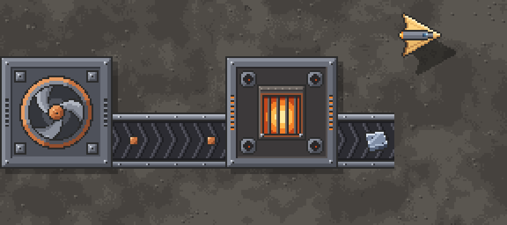
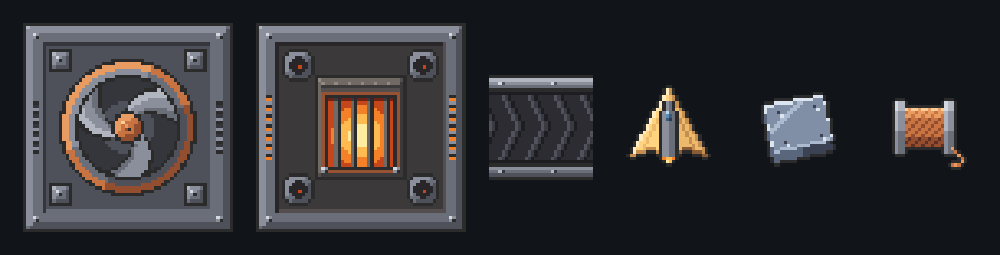

<p align="center">
  
</p>

<p align="center">
  <a href="https://github.com/Juan0177/tIndustry/releases/latest"></a>
  <a href="https://github.com/Juan0177/tIndustry/actions/workflows/build-publish.yml"></a>
  
  
</p>

<p align="center">
  <b><a href="https://github.com/Juan0177/tIndustry/releases/latest">Scarica</a></b> ·
  <a href="#gioca">Gioca</a> ·
  <a href="#cosa-cè-nel-gioco">Contenuti</a> ·
  <a href="#stato-e-roadmap">Roadmap</a> ·
  <a href="#sviluppo">Sviluppo</a> ·
  <a href="CHANGELOG.md">Changelog</a>
</p>

**tIndustry** è un gioco di logistica industriale ispirato a **Mindustry** e **Tiny Industry**: estrai minerali, portali al CORE su nastri, fondili in lastre e fili, vendili al Mercato e reinvesti in Ricerca per sbloccare nuovi blocchi.

```text
  minatore ──▶ nastro ──▶ forno ──▶ lastre / fili ──▶ CORE ──▶ Mercato
                            ▲                                    │
              carbone oppure corrente                            ▼
                 generatore ──▶ nodi                    $ ──▶ Ricerca ──▶ nuovi blocchi
```

<table>
  <tr>
    <td width="50%"><br><sub><b>Fabbrica</b> · il minatore porta il minerale al CORE sul nastro</sub></td>
    <td width="50%"><br><sub><b>Ricerca</b> · albero a rami come in Mindustry</sub></td>
  </tr>
  <tr>
    <td width="50%"><br><sub><b>Mercato</b> · prezzi dinamici e vendita automatica</sub></td>
    <td width="50%"><br><sub><b>Campagna</b> · 10 livelli con tutorial non bloccante</sub></td>
  </tr>
</table>

### Anteprima della grafica nuova

Pixel-art originale in stile Mindustry, generata da script, che sostituirà la grafica di oggi con l'upgrade grafico (G1).

<p align="center">
  
</p>
<p align="center">
  
  <br><sub>Minatore · forno · nastro · drone costruttore · lastra di ferro · filo di rame (scala ×4)</sub>
</p>

---

## Gioca

Scarica l'ultima [Release](https://github.com/Juan0177/tIndustry/releases/latest), estrai lo zip ed esegui:

| Sistema | File | Eseguibile |
| --- | --- | --- |
| Windows | `tIndustry-win-x64.zip` | `tIndustry.exe` |
| Linux | `tIndustry-linux-x64.zip` | `tIndustry.x86_64` |

Gli zip `tIndustry-godot-*-x64.zip` hanno lo stesso contenuto (nomi storici).

### Prima partita

1. Dalla Home scegli **Continua**, **Campagna** o **Nuova partita**.
2. Piazza un **Minatore** (`2`) su un minerale e collegalo al CORE con i **nastri** (`1`, `R` per ruotare).
3. Apri il **Mercato** (`M`) e vendi quello che arriva al CORE.
4. Con i fondi apri la **Ricerca** (`T`) e sblocca forno, nastri veloci, energia…
5. La **Campagna** (`G`) ti guida con obiettivi; il tutorial avanza da solo mentre giochi.

| Tasto | Azione | Tasto | Azione |
| --- | --- | --- | --- |
| `1`–`9` | scegli il blocco | `R` | ruota |
| clic / trascina | pianifica (il drone costruisce) | tasto destro | cancella o smonta |
| `WASD` / trascina | sposta la visuale | rotella | zoom |
| `H` | torna al CORE | `Esc` | cursore (nessun blocco) |
| `M` · `T` · `G` | Mercato · Ricerca · Campagna | `C` | cambia il filtro del selezionatore |

Controlli completi, salvataggi, Ricerca e Mercato: [`godot/README.md`](godot/README.md).

---

## Cosa c'è nel gioco

| Area | Contenuto |
| --- | --- |
| **Mondo** | Mappa 1000×1000 generata da seed, CORE al centro, minerali visibili (ferro, rame, piombo, carbone, titanio…) |
| **Produzione** | Minatore T1/T2, estrattore, forno multi-ricetta (carbone o corrente), assemblatore |
| **Logistica** | Nastri T1/T2/T3, incrocio, sdoppiatore, selezionatore con filtro, ponte (2–4 caselle) |
| **Energia** | Generatore, nodi T1/T2 con buffer di capacità |
| **Economia** | Fondi, costi e rimborsi, Mercato a prezzo dinamico, vendita automatica, potenziamento del CORE |
| **Ricerca** | Albero stile Mindustry dal CORE, a rami: Logistica, Produzione, Energia |
| **Campagna** | 10 livelli, da *Primi passi* a *Espansione T2*, con tutorial non bloccante |
| **Salvataggi** | Continua (autosave con copia di riserva), slot, Salva come; formato versione 11 |

Il combattimento è fuori dal progetto per ora.

---

## Stato e roadmap

Il lavoro procede per sotto-progetti, ognuno con spec, piano, revisioni e un [diario](docs/diario/README.md). Le scelte di fondo sono raccolte in [`docs/decisioni.md`](docs/decisioni.md). Chi usa Obsidian trova la mappa completa in [`docs/mappa-progetto.canvas`](docs/mappa-progetto.canvas).

| Stato | Sotto-progetto | Cosa porta |
| --- | --- | --- |
| Fatto | **1 · Riordino** | Struttura del repo, documentazione, avvio di sviluppo in un comando |
| Fatto | **2 · Simulazione a comandi** | Tick fisso a 60/s, sistemi in ordine fisso, comandi validati, istantanea con checksum, base per il co-op |
| In corso | **3 · Costruzione come Mindustry** | Piani in coda, drone che vola e costruisce, cantieri con consumo e rimborso graduali ([ADR 0003](docs/decisioni/0003-costruzione-come-mindustry.md)); simulazione in `main`, gioco e documentazione in arrivo con le PR #164 e #166 |
| Previsto | **G1–G4 · Upgrade grafico** | Pixel-art originale in stile Mindustry: blocchi, terreno, effetti e luci, interfaccia |
| Previsto | **4 · Drone e tier** | Il drone lo comandi tu; CORE shard → foundation → nucleus e droni alpha → beta → gamma |
| Previsto | **5 · Co-op** | Server C# e sincronizzazione ibrida ([ADR 0002](docs/decisioni/0002-sincronizzazione-ibrida.md)) |

---

## Sviluppo

Requisiti: [.NET 8 SDK](https://dotnet.microsoft.com/download) e [Godot 4.4 .NET (mono)](https://godotengine.org/download) come comando `godot4`.

### Avvio rapido

```bash
tools/dev/dev.sh                 # Linux/macOS (bash)
dev.cmd                          # Windows, dalla radice del repo (usa Git Bash)
```

Il comando controlla gli strumenti, compila, importa gli asset se serve e avvia il gioco. Le opzioni sono le stesse per entrambi:

| Opzione | Effetto |
| --- | --- |
| `--profilo-temp` | profilo dati temporaneo: non tocca impostazioni e salvataggi reali (**consigliato per le prove**) |
| `--nuova` | salta la Home e apre una nuova partita |
| `--editor` | apre l'editor Godot |
| `--test` | esegue i test prima di avviare |
| `--playtest ui\|tutorial` | playtest automatico con screenshot in `.dev/` |
| `--solo-build` | compila e basta |
| `--help` | tutte le opzioni |

<details>
<summary><b>Passo per passo, test e playtest</b></summary>

```bash
dotnet build tIndustry.sln -c Release -nologo -v q              # 0 errori, 0 avvisi
dotnet test tests/TIndustry.Shared.Tests -c Release --no-build
godot4 --path godot                                             # legge i contenuti da data/
TINDUSTRY_FRESH=1 godot4 --path godot                           # ignora il salvataggio Continua
```

- **Test** (`tests/TIndustry.Shared.Tests`, xUnit): nastri, craft, energia, costruzione, salvataggi, Ricerca, Mercato, Campagna, determinismo della simulazione e validazione di `data/`. Usano sempre una cartella temporanea.
- **Playtest** (`tools/dev/playtest.sh ui|tutorial <cartella>`): giocano UI e tutorial con input simulati in un profilo dati isolato, cartella utente di Godot compresa. Producono un PNG per passo e l'esito `PLAYTEST OK`.
- **Confronto screenshot**: `python tools/dev/compare_shots.py <baseline> <nuovi>`.

Per provare senza toccare i tuoi dati, imposta `TINDUSTRY_DATA_DIR` su una cartella temporanea; gli script lo fanno da soli.

</details>

<details>
<summary><b>Struttura del repository</b></summary>

| Percorso | Ruolo |
| --- | --- |
| `godot/` | Client di gioco: mondo, HUD, pannelli, grafica |
| `src/TIndustry.Shared/` | Simulazione indipendente da Godot: griglia, nastri, edifici, costruzione, energia, economia, ricerca, campagna, salvataggi |
| `data/` | Unica fonte dei contenuti: `content.json`, `campaign.json` |
| `tests/` | Test xUnit della simulazione |
| `tools/` | `dev/`: avvio, playtest, screenshot e mappa Obsidian · `ci/`: export |
| `docs/` | [Architettura](docs/ARCHITETTURA.md), [decisioni](docs/decisioni.md), specifiche e piani, [diario di lavoro](docs/diario/README.md) |

La simulazione gira a tick fissi di 1/60 s, in modo deterministico. Per orientarti nel codice (ciclo di frame, dati, salvataggi, come aggiungere un blocco) parti da [`docs/ARCHITETTURA.md`](docs/ARCHITETTURA.md); per lavorare con agenti, [`CLAUDE.md`](CLAUDE.md).

</details>

<details>
<summary><b>Release</b></summary>

I workflow GitHub Actions non partono su push o PR:

- [`release.yml`](.github/workflows/release.yml): su tag `v*` o avvio manuale. Esegue i test e l'export Godot e mette gli zip nella Release.
- [`build-publish.yml`](.github/workflows/build-publish.yml): solo manuale. Build e test.

Export in locale: `tools/ci/setup-godot.sh` (una tantum), poi `tools/ci/export-godot.sh` → `dist/tIndustry-*-x64.zip`.

Il vecchio client Raylib è stato rimosso dopo la 0.3.4: il codice resta nel tag `v0.3.4`, gli zip nelle Release fino alla v0.3.4.

</details>

---

## Crediti

Icone da [game-icons.net](https://game-icons.net) (CC BY 3.0) e [Kenney](https://kenney.nl) (CC0): dettagli in [`godot/assets/ATTRIBUTION.md`](godot/assets/ATTRIBUTION.md). La nuova pixel-art in arrivo è originale e generata da script.

Storia delle versioni: [CHANGELOG.md](CHANGELOG.md).

<p align="center"><i>Buon layout. Che i nastri non si intasino.</i></p>
