<p align="center">
  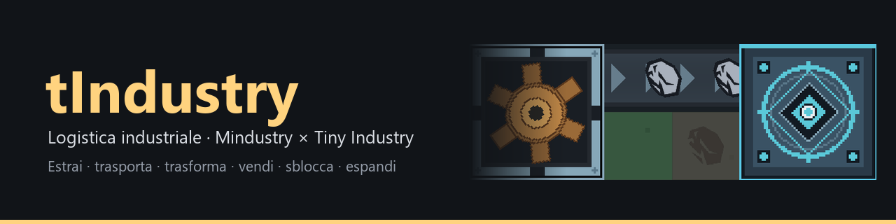
</p>

<p align="center">
  <a href="https://github.com/Juan0177/tIndustry/releases/latest"></a>
  <a href="https://github.com/Juan0177/tIndustry/actions/workflows/build-publish.yml"></a>
  
  
</p>

<p align="center">
  <b><a href="https://github.com/Juan0177/tIndustry/releases/latest">Scarica</a></b> ·
  <a href="#gioca">Gioca</a> ·
  <a href="#cosa-cè-nel-gioco">Contenuti</a> ·
  <a href="#stato-e-roadmap">Roadmap</a> ·
  <a href="#sviluppo">Sviluppo</a> ·
  <a href="CHANGELOG.md">Changelog</a> ·
  <a href="https://juan0177.github.io/tIndustry/">Sito</a>
</p>

**tIndustry** è un gioco di logistica industriale ispirato a **Mindustry** e **Tiny Industry**: estrai minerali, portali al CORE su nastri, fondili in lastre e fili, vendili al Mercato e reinvesti in Ricerca per sbloccare nuovi blocchi.

```text
  minatore ──▶ nastro ──▶ forno ──▶ lastre / fili ──▶ CORE ──▶ Mercato
                            ▲                                    │
              carbone oppure corrente                            ▼
                 generatore ──▶ nodi                    $ ──▶ Ricerca ──▶ nuovi blocchi
```

<table>
  <tr>
    <td width="50%">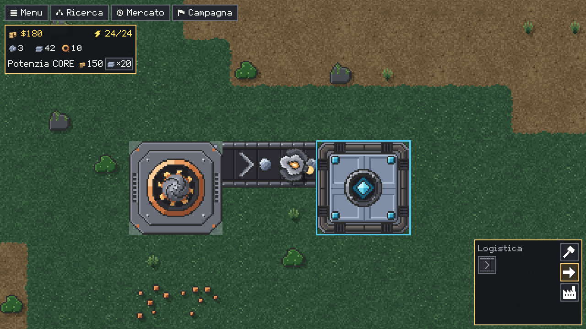<br><sub><b>Fabbrica</b> · il minatore porta il minerale al CORE sul nastro</sub></td>
    <td width="50%">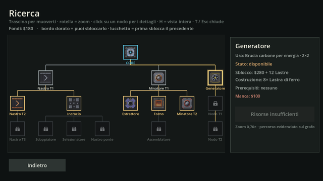<br><sub><b>Ricerca</b> · albero a rami come in Mindustry</sub></td>
  </tr>
  <tr>
    <td width="50%">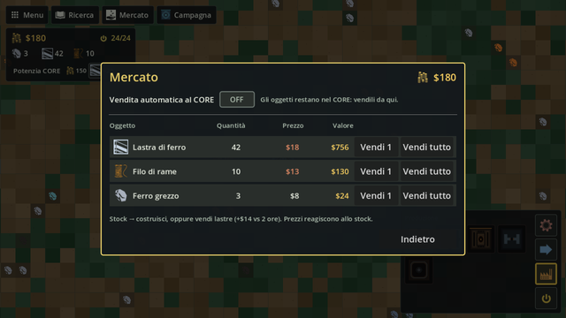<br><sub><b>Mercato</b> · rialzi, crolli e vendita automatica per oggetto</sub></td>
    <td width="50%">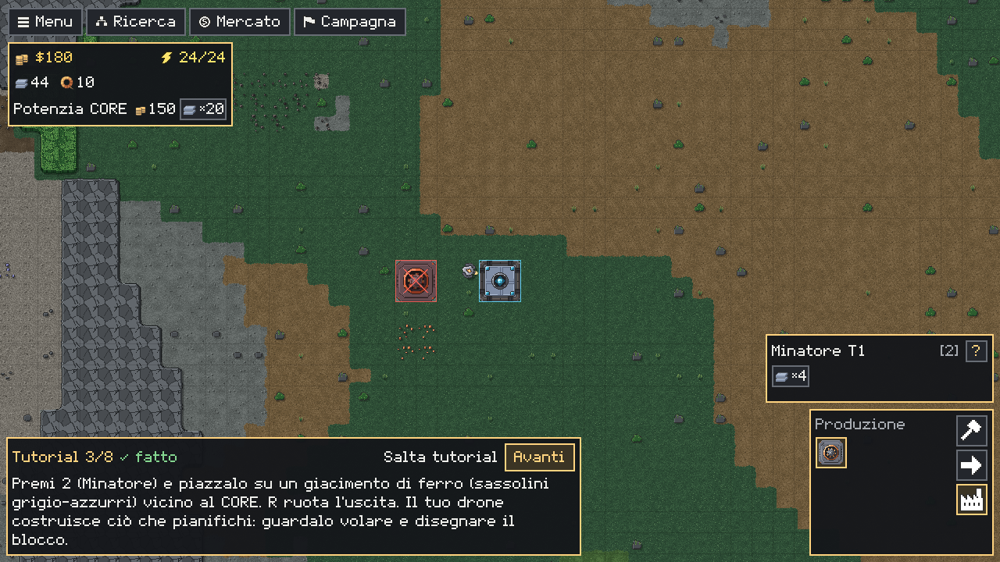<br><sub><b>Campagna</b> · 10 livelli con tutorial non bloccante</sub></td>
  </tr>
</table>

### Interfaccia

Un solo tema in stile Mindustry per HUD, pannelli e menu: pannelli quasi neri col bordo giallo-arancio, carattere pixel nostro con le lettere accentate, icone pixel bianche, logo e caselle di spunta generati da `tools/art`. Testi in **italiano e inglese**, **Scala UI** dal 75% al 200% che ingrandisce solo l'interfaccia (il mondo resta 1:1), colori **per daltonici** e ad **alto contrasto**, e segni che non dipendono dal colore (X sull'anteprima rifiutata, tratteggio sullo smontaggio). Catture dai playtest.

<table>
  <tr>
    <td width="50%">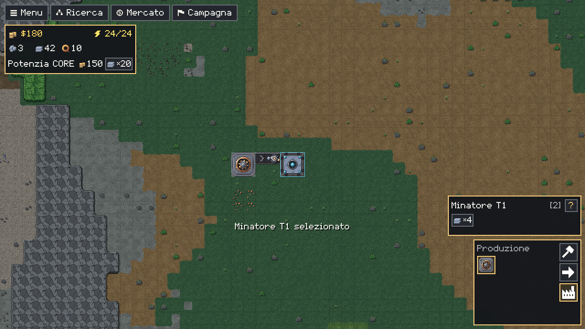<br><sub><b>HUD</b> · fondi, energia, risorse del CORE e palette con il pannello del blocco</sub></td>
    <td width="50%">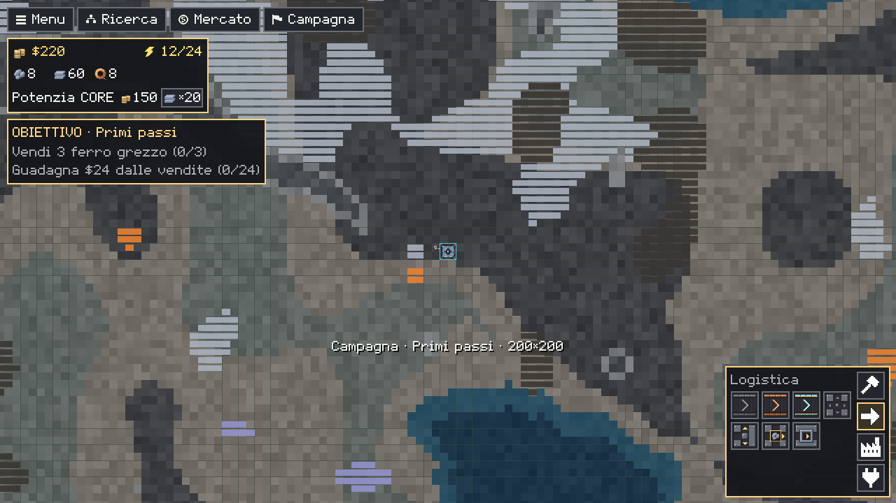<br><sub><b>Palette</b> · griglia fissa come Mindustry, solo i blocchi sbloccati</sub></td>
  </tr>
  <tr>
    <td width="50%">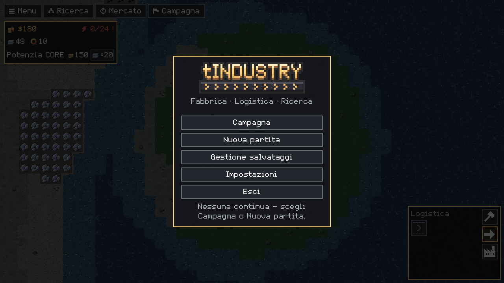<br><sub><b>Home</b> · logo pixel e la mappa che scorre dietro</sub></td>
    <td width="50%">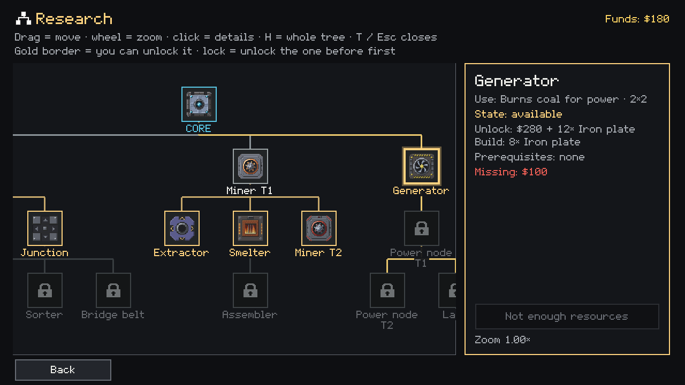<br><sub><b>English</b> · tutti i testi anche in inglese</sub></td>
  </tr>
  <tr>
    <td width="50%">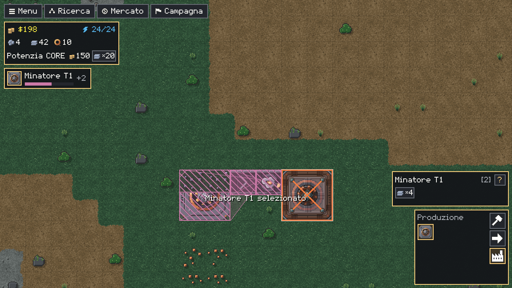<br><sub><b>Daltonici</b> · anteprima rifiutata con la X, smontaggio tratteggiato</sub></td>
    <td width="50%">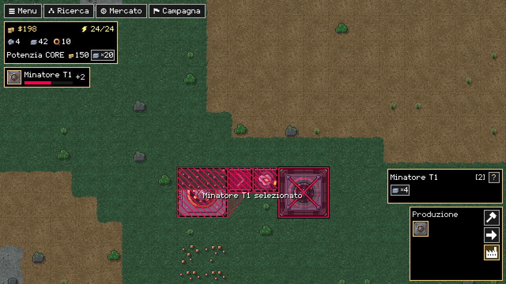<br><sub><b>Alto contrasto</b> · pannelli neri, testo bianco, segni col bordo nero</sub></td>
  </tr>
</table>

### Grafica

Pixel-art originale in stile Mindustry, generata da script (`tools/art/genera.py`): edifici a strati con parti animate, nastri a tre tier, Core e drone, oggetti senza tinta e il terreno dei quattro biomi con bordi, pareti in rilievo, acqua e giacimenti a puntini. Sopra c'è uno strato di effetti: fumo, scintille e vapore dei blocchi al lavoro, neve, sabbia e foglie d'ambiente, ombre sotto gli edifici, bagliore e, a scelta, la notte con la Lampada. Effetti, ombre, limite di FPS e scala di rendering si regolano dalle Impostazioni, per i PC meno potenti. Catture dal gioco.

<p align="center">
  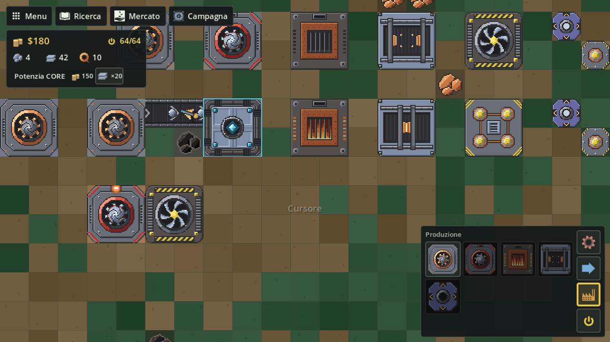
  <br><sub>Blocchi di produzione e potenza in funzione</sub>
</p>
<p align="center">
  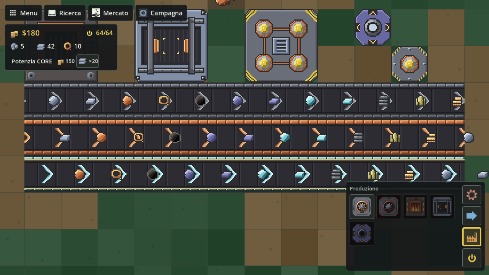
  <br><sub>Ogni oggetto sui tre tier di nastro</sub>
</p>
<p align="center">
  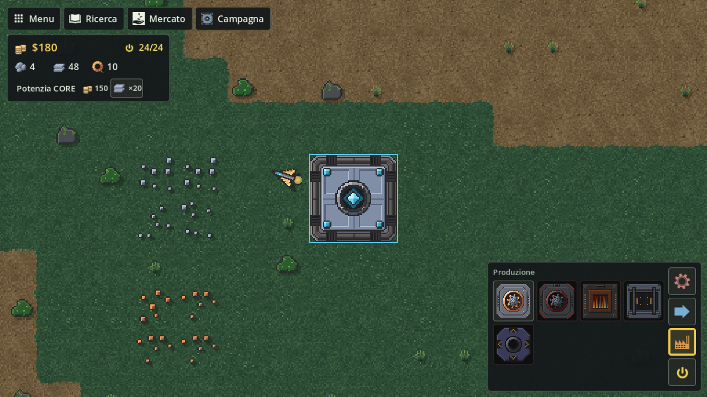
  <br><sub>Partenza di una partita sul terreno nuovo</sub>
</p>
<table>
  <tr>
    <td width="50%">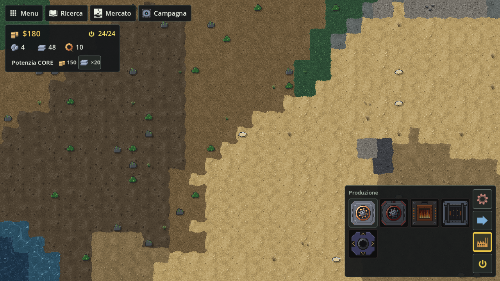<br><sub><b>Biomi</b> · suoli, bordi, pareti in rilievo e acqua</sub></td>
    <td width="50%">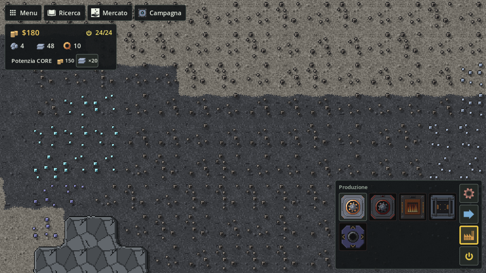<br><sub><b>Giacimenti</b> · puntini che si leggono sul suolo</sub></td>
  </tr>
</table>

---

## Gioca

Scarica l'ultima [Release](https://github.com/Juan0177/tIndustry/releases/latest), estrai lo zip ed esegui:

| Sistema | File | Eseguibile |
| --- | --- | --- |
| Windows | `tIndustry-win-x64.zip` | `tIndustry.exe` |
| Linux | `tIndustry-linux-x64.zip` | `tIndustry.x86_64` |

### Prima partita

1. Dalla Home scegli **Continua**, **Campagna** o **Nuova partita**.
2. Piazza un **Minatore** (`2`) su un minerale e collegalo al CORE con i **nastri** (`1`, `R` per ruotare).
3. Apri il **Mercato** (`M`) e vendi quello che arriva al CORE.
4. Con i fondi apri la **Ricerca** (`T`) e sblocca forno, nastri veloci, energia…
5. La **Campagna** (`G`) ti guida con obiettivi; il tutorial avanza da solo mentre giochi.

| Tasto | Azione | Tasto | Azione |
| --- | --- | --- | --- |
| `1`–`9` | scegli il blocco | `R` | ruota |
| clic / trascina | pianifica (il drone costruisce) | tasto destro | cancella o smonta |
| `WASD` / trascina | sposta la visuale | rotella | zoom |
| `H` | torna al CORE | `Esc` | cursore (nessun blocco) |
| `M` · `T` · `G` | Mercato · Ricerca · Campagna | `C` | cambia il filtro del selezionatore |

Controlli completi, salvataggi, Ricerca e Mercato: [`godot/README.md`](godot/README.md).

---

## Cosa c'è nel gioco

| Area | Contenuto |
| --- | --- |
| **Mondo** | Mappe generate dal seme in tre misure (Media 1000², Grande 1500², Enorme 2000²) con quattro biomi (rocce, sabbia, neve, prati), pareti, laghi e fiumi; acqua bassa costruibile, acqua profonda solo col ponte; CORE al centro con ferro, rame e carbone raggiungibili; minerali visibili (ferro, rame, piombo, carbone, titanio) |
| **Produzione** | Minatore T1/T2, estrattore, forno multi-ricetta (carbone o corrente), assemblatore |
| **Logistica** | Nastri T1/T2/T3, incrocio, sdoppiatore, selezionatore con filtro, ponte (2–4 caselle) |
| **Energia** | Generatore, nodi T1/T2 con buffer di capacità, Lampada |
| **Economia** | Fondi, costi e rimborsi, Mercato come una borsa (prezzi che si muovono, picchi fino al triplo, crolli se svendi, vendita automatica per oggetto al prezzo minimo), potenziamento del CORE |
| **Ricerca** | Albero stile Mindustry dal CORE, a rami: Logistica, Produzione, Energia |
| **Campagna** | 10 livelli su mappe prestabilite, da 200×200 (*Primi passi*) a 1000×1000 (*Espansione T2*), con tutorial non bloccante |
| **Interfaccia** | Tema unico in stile Mindustry, carattere pixel nostro, italiano e inglese, Scala UI 75–200% solo dell'interfaccia, colori normali, per daltonici e ad alto contrasto; schermo intero alla risoluzione dello schermo |
| **Salvataggi** | Continua (autosave con copia di riserva), slot, Salva come; formato versione 14 (i v11, v12 e v13 si caricano ancora) |

Il combattimento è fuori dal progetto per ora.

---

## Stato e roadmap

Il lavoro procede per sotto-progetti, ognuno con spec, piano, revisioni e un [diario](docs/diario/README.md). Le scelte di fondo sono raccolte in [`docs/decisioni.md`](docs/decisioni.md); le idee non ancora pianificate in [`docs/idee.md`](docs/idee.md). Chi usa Obsidian trova la mappa completa in [`docs/mappa-progetto.canvas`](docs/mappa-progetto.canvas); a che punto siamo e cosa manca oggi è in [`docs/STATO.md`](docs/STATO.md).
| Stato | Sotto-progetto | Cosa porta |
| --- | --- | --- |
| Fatto | **1 · Riordino** | Struttura del repo, documentazione, avvio di sviluppo in un comando |
| Fatto | **2 · Simulazione a comandi** | Tick fisso a 60/s, sistemi in ordine fisso, comandi validati, istantanea con checksum, base per il co-op |
| Fatto | **3 · Costruzione come Mindustry** | Piani in coda, drone che vola e costruisce, cantieri con consumo e rimborso graduali ([ADR 0003](docs/decisioni/0003-costruzione-come-mindustry.md)) |
| Fatto | **G1 · Arte dei blocchi** | Pixel-art nostra generata da script: edifici a strati con parti animate, nastri a tre tier, oggetti, Core in 4 tier, droni alpha / beta / gamma ([ADR 0004](docs/decisioni/0004-arte-generata-da-script.md)) |
| Fatto | **G2a · Mappe e terreno** | Mappe a seme in 3 misure, 4 biomi, pareti, acqua bassa e profonda, mappe della campagna in file, schermata Nuova partita, salvataggi v12 ([ADR 0005](docs/decisioni/0005-mappe-seme-e-file.md)) |
| Fatto | **G2b · Arte del terreno** | Suoli con varianti e bordi, pareti in rilievo raccordate, acqua con increspature, giacimenti a puntini, decorazioni per bioma, due livelli di dettaglio ([ADR 0004](docs/decisioni/0004-arte-generata-da-script.md#terreno-g2b)) |
| Fatto, in attesa dell'ok | **G3 · Effetti e luci** | Particelle di lavoro, costruzione e ambiente, ombre, bagliore, notte opzionale con la Lampada, impostazioni grafiche per PC deboli ([spec](docs/superpowers/specs/2026-10-18-g3-effetti-luci-design.md)) |
| Fatto | **G4 · Interfaccia** | Tema unico in stile Mindustry, carattere pixel e icone generati, italiano e inglese, Scala UI solo dell'interfaccia, schermo intero, colori per daltonici e alto contrasto ([ADR 0006](docs/decisioni/0006-interfaccia-lingue-carattere.md)) |
| Fatto | **Sito web su GitHub Pages** | [Vetrina «fabbrica»](https://juan0177.github.io/tIndustry/) con le catene di produzione vere sui nastri del gioco, download, [sviluppo](https://juan0177.github.io/tIndustry/sviluppo/) (ADR, roadmap, diario) e [tutti gli asset](https://juan0177.github.io/tIndustry/asset/), generati da `tools/sito/costruisci.py`; il [racconto](https://juan0177.github.io/tIndustry/racconto/) guidato dallo scroll, «dal giacimento al CORE», è pubblicato in `racconto/` ma resta fuori dalla barra finché non è approvato ([spec](docs/superpowers/specs/2026-10-20-sito-scroll-narrativo.md)) |
| Fatto | **Mercato come una borsa (specifica 1 di 3)** | Prezzi per oggetto con picchi e crolli, vendite al prezzo del clic, vendita automatica per oggetto, jackpot e rete di sicurezza nella simulazione, salvataggi v14, panoramica del Mercato ([specifica](docs/superpowers/specs/2026-10-22-mercato-borsa-design.md), [diario](docs/diario/2026-10-22-mercato-borsa.md), [spiegazione](https://github.com/Juan0177/tIndustry/wiki/Mercato-come-una-borsa)) |
| Previsto | **Mercato 2 · Schermo di borsa** | Blocco accanto al CORE, sequenza del «Vendi tutto» col drone, LED, moduli e ramo Finanza della Ricerca; con lo schermo il jackpot scatta anche in partita |
| Previsto | **Mercato 3 · Magazzino del CORE e livelli** | Massimo per oggetto, linee che si fermano a CORE pieno, drone più veloce per livello |
| Previsto | **Bilanciamento dei giacimenti (generatore biomi-2)** | Rarità per minerale, titanio più lontano dal Core, partenza garantita più ricca, macchie più fitte; generatore nuovo, `biomi-1` resta congelato |
| Previsto | **4 · Drone e tier** | Il drone lo comandi tu; CORE shard → foundation → nucleus e droni alpha → beta → gamma |
| Previsto | **Attacco e difesa** | Unità nemiche e difese. I nemici arrivano **solo di notte**: quando torna il giorno i superstiti scappano, se il CORE ha resistito; se lo distruggono è **Game Over**. Il drone si mette l'elmetto durante l'attacco |
| Previsto | **5 · Co-op** | Server C# e sincronizzazione ibrida ([ADR 0002](docs/decisioni/0002-sincronizzazione-ibrida.md)) |


A che punto siamo, aspetto per aspetto:

<!-- barra-stato:inizio -->
**Avanzamento del gioco: 39%** (26 passi fatti su 66, [dettaglio](docs/STATO.md))

```text
███░│████│█░░░│████│█░░░│█░░░│█░░░│██░░│███░│███░│░░░░│░░░░│░░░░│░░░░│███░│███░
```

| # | Aspetto | Avanzamento | % |
| --- | --- | --- | --- |
| 1 | [Fondamenta tecniche](docs/ARCHITETTURA.md) | `███████░░░` | 67% (4/6) |
| 2 | [Costruzione](https://github.com/Juan0177/tIndustry/wiki/Costruzione) | `██████████` | 100% (2/2) |
| 3 | [Logistica](https://github.com/Juan0177/tIndustry/wiki/Logistica) | `███░░░░░░░` | 29% (2/7) |
| 4 | [Produzione](https://github.com/Juan0177/tIndustry/wiki/Produzione) | `██████████` | 100% (2/2) |
| 5 | [Energia](https://github.com/Juan0177/tIndustry/wiki/Energia) | `██░░░░░░░░` | 20% (1/5) |
| 6 | [Mercato ed economia](https://github.com/Juan0177/tIndustry/wiki/Mercato-come-una-borsa) | `██░░░░░░░░` | 20% (1/5) |
| 7 | [Mappe e terreno](https://github.com/Juan0177/tIndustry/wiki/Mappe-e-terreno) | `███░░░░░░░` | 33% (2/6) |
| 8 | [Campagna](https://github.com/Juan0177/tIndustry/wiki/Campagna-e-mappe) | `█████░░░░░` | 50% (1/2) |
| 9 | [Grafica ed effetti](https://github.com/Juan0177/tIndustry/wiki/Arte-generata) | `███████░░░` | 67% (2/3) |
| 10 | [Interfaccia](https://github.com/Juan0177/tIndustry/wiki/Interfaccia-e-lingue) | `███████░░░` | 67% (2/3) |
| 11 | [Drone e tier](https://github.com/Juan0177/tIndustry#stato-e-roadmap) | `░░░░░░░░░░` | 0% (0/4) |
| 12 | [Liquidi](https://github.com/Juan0177/tIndustry#stato-e-roadmap) | `░░░░░░░░░░` | 0% (0/4) |
| 13 | [Attacco e difesa](https://github.com/Juan0177/tIndustry#stato-e-roadmap) | `░░░░░░░░░░` | 0% (0/4) |
| 14 | [Co-op](docs/decisioni/0002-sincronizzazione-ibrida.md) | `░░░░░░░░░░` | 0% (0/4) |
| 15 | [Sito web](https://github.com/Juan0177/tIndustry/wiki/Sito-web) | `████████░░` | 80% (4/5) |
| 16 | [Wiki](https://github.com/Juan0177/tIndustry/wiki/) | `████████░░` | 75% (3/4) |
<!-- barra-stato:fine -->
---

## Sviluppo

Requisiti: [.NET 8 SDK](https://dotnet.microsoft.com/download) e [Godot 4.4 .NET (mono)](https://godotengine.org/download) come comando `godot4`.

Gli agenti AI giocano e cercano bug con il server MCP `tindustry` (`.mcp.json`, Claude Code lo avvia da solo): vedi [`tools/AgentPlay/README.md`](tools/AgentPlay/README.md).

### Avvio rapido

```bash
tools/dev/dev.sh                 # Linux/macOS (bash)
dev.cmd                          # Windows, dalla radice del repo (usa Git Bash)
```

Il comando controlla gli strumenti, compila, importa gli asset se serve e avvia il gioco. Le opzioni sono le stesse per entrambi:

| Opzione | Effetto |
| --- | --- |
| `--profilo-temp` | profilo dati temporaneo: non tocca impostazioni e salvataggi reali (**consigliato per le prove**) |
| `--profilo DIR` | usa `DIR` come profilo dati, che resta tra un avvio e l'altro |
| `--nuova` | salta la Home e apre una nuova partita |
| `--editor` | apre l'editor Godot |
| `--test` | esegue i test prima di avviare |
| `--playtest ui\|tutorial\|agenti` | playtest automatico con screenshot in `.dev/` |
| `--solo-build` | compila e basta |
| `--import` | forza la reimportazione degli asset Godot |
| `--help` | tutte le opzioni |

<details>
<summary><b>Passo per passo, test e playtest</b></summary>

```bash
dotnet build tIndustry.sln -c Release -nologo -v q              # 0 errori, 0 avvisi
dotnet test tests/TIndustry.Shared.Tests -c Release --no-build
godot4 --path godot                                             # legge i contenuti da data/
TINDUSTRY_FRESH=1 godot4 --path godot                           # ignora il salvataggio Continua
```

- **Test** (`tests/TIndustry.Shared.Tests`, xUnit): nastri, craft, energia, costruzione, salvataggi, Ricerca, Mercato, Campagna, determinismo della simulazione e validazione di `data/`. Usano sempre una cartella temporanea.
- **Playtest** (`tools/dev/playtest.sh ui|tutorial|agenti <cartella>`): giocano UI e tutorial con input simulati, `agenti` prova il canale di controllo usato dagli agenti, in un profilo dati isolato, cartella utente di Godot compresa, sempre in una finestra 1280×720 al 100%; `TINDUSTRY_PLAYTEST_LINGUA=en` li gioca in inglese. Producono un PNG per passo e l'esito `PLAYTEST OK`.
- **Confronto screenshot**: `python tools/dev/compare_shots.py <baseline> <nuovi>`.

Per provare senza toccare i tuoi dati, imposta `TINDUSTRY_DATA_DIR` su una cartella temporanea; gli script lo fanno da soli.

</details>

<details>
<summary><b>Struttura del repository</b></summary>

| Percorso | Ruolo |
| --- | --- |
| `godot/` | Client di gioco: mondo, HUD, pannelli, grafica, testi in `lingue/testi.csv` |
| `src/TIndustry.Shared/` | Simulazione indipendente da Godot: griglia, nastri, edifici, costruzione, energia, economia, ricerca, campagna, salvataggi |
| `data/` | Unica fonte dei contenuti: `content.json`, `campaign.json`, `maps/` (mappe della campagna) |
| `tests/` | Test xUnit: `TIndustry.Shared.Tests` (simulazione) e `TIndustry.AgentPlay.Tests` (server MCP degli agenti) |
| `tools/` | `dev/`: avvio, playtest, screenshot e mappa Obsidian · `MapTool/`: mappe della campagna · `art/`: sprite, icone e carattere · `sito/`: sito su GitHub Pages · `ci/`: export |
| `docs/` | [Architettura](docs/ARCHITETTURA.md), [decisioni](docs/decisioni.md), specifiche e piani, [diario di lavoro](docs/diario/README.md) |

La simulazione gira a tick fissi di 1/60 s, in modo deterministico. Per orientarti nel codice (ciclo di frame, dati, salvataggi, come aggiungere un blocco) parti da [`docs/ARCHITETTURA.md`](docs/ARCHITETTURA.md); per lavorare con agenti, [`CLAUDE.md`](CLAUDE.md).

</details>

<details>
<summary><b>Release</b></summary>

I workflow GitHub Actions non partono su push o PR:

- [`release.yml`](.github/workflows/release.yml): su tag `v*` o avvio manuale. Esegue i test e l'export Godot e mette gli zip nella Release.
- [`build-publish.yml`](.github/workflows/build-publish.yml): solo manuale. Build e test.
- [`pages.yml`](.github/workflows/pages.yml): su tag `v*` o avvio manuale da `main`. Costruisce il sito con `tools/sito/costruisci.py` e lo pubblica su GitHub Pages.
- [`wiki.yml`](.github/workflows/wiki.yml): solo manuale. Controlla `docs/wiki/` e la copia nella Wiki del repository.

Export in locale: `tools/ci/setup-godot.sh` (una tantum), poi `tools/ci/export-godot.sh` → `dist/tIndustry-*-x64.zip`.

Il vecchio client Raylib è stato rimosso dopo la 0.3.4: il codice resta nel tag `v0.3.4`, gli zip nelle Release fino alla v0.3.4.

</details>

---

## Crediti

Tutta la grafica, le icone e il carattere dell'interfaccia sono originali e generati da script (`tools/art`); nessun asset di terzi ([`godot/assets/ATTRIBUTION.md`](godot/assets/ATTRIBUTION.md)).

Storia delle versioni: [CHANGELOG.md](CHANGELOG.md).

<p align="center"><i>Buon layout. Che i nastri non si intasino.</i></p>
