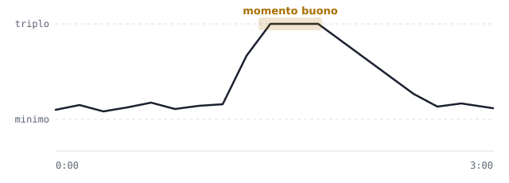

# Vendere in tIndustry: ci serve il tuo parere

tIndustry è un gioco in cui costruisci una fabbrica: scavi minerali, li porti in magazzino, li trasformi in prodotti e li vendi per guadagnare e costruire di più. Stiamo cambiando il modo in cui si vende, e vorremmo sapere cosa ne pensi.

## Come funzionerà

**I prezzi si muovono, come in borsa.** Ogni prodotto ha un prezzo minimo sotto il quale non scende mai. Di solito il prezzo sta un po' sopra il minimo e cambia di continuo, piano piano.

**Ogni tanto il prezzo schizza in alto.** Più o meno ogni quarto d'ora, per ogni prodotto, il prezzo sale in un attimo fino al triplo, resta lì qualche secondo e poi riscende. Chi vende in quel momento guadagna molto di più.

**Se vendi troppo tutto insieme, il prezzo crolla.** Come quando tutti vendono la stessa cosa nello stesso momento: per una ventina di minuti quel prodotto vale solo il minimo, e niente più rialzi. Gli altri prodotti non se ne accorgono: il crollo riguarda solo quello che hai svenduto.

**Puoi anche non pensarci.** C'è una vendita automatica che vende da sola man mano che produci. È comoda, ma vende sempre al prezzo minimo.

## Il colpo di fortuna

Se durante un rialzo vendi in un colpo solo una quantità enorme di un prodotto, puoi vincere un **jackpot**: quella vendita vale circa **dieci volte** il normale.

- Più vendi, più è probabile. Con quantità piccole è raro; al massimo è **testa o croce** (una possibilità su due).
- Che vinca o no, una vendita così grande fa comunque crollare il prezzo di quel prodotto per un po'.

**La «rete di sicurezza».** Per non far arrabbiare chi è sfortunato, ogni volta che tenti il colpo grosso e non va, la volta dopo è più facile. Dopo **tre tentativi andati male di fila, il quarto vince di sicuro**. Funziona come in tanti giochi per telefono, dove dopo un certo numero di tentativi il premio raro è garantito.

## Due esempi

**1. Aspettare conviene.** Hai 1.000 lastre di ferro da vendere.
- Le vendi subito con la vendita automatica: **23.000 $**.
- Aspetti un rialzo e le vendi lì: **67.000 $**, quasi il triplo.

**2. Il testa o croce.** Hai messo da parte una montagna di ferro e arriva un rialzo. Decidi di venderlo tutto in un colpo.
- Se va bene, jackpot: **630.000 $**.
- Se va male: **170.000 $**, che è comunque molto più dei 60.000 $ che avresti preso vendendo con calma al minimo.
- In tutti e due i casi il ferro poi resta fermo al minimo per un po', e intanto conviene vendere altro.

## Cosa ne pensi?

1. Ti piace l'idea che i prezzi si muovano e che convenga aspettare il momento giusto, o preferiresti vendere senza pensarci?
2. Il jackpot ti sembra divertente o troppo legato alla fortuna?
3. La «rete di sicurezza» (vittoria garantita dopo tre tentativi andati male) è giusta, troppo generosa o troppo avara?
4. Ti sembra giusto che un tentativo andato male faccia comunque crollare il prezzo, o è una punizione troppo dura?
5. Secondo te il gioco rischia di diventare più un gioco di borsa che di fabbriche?
