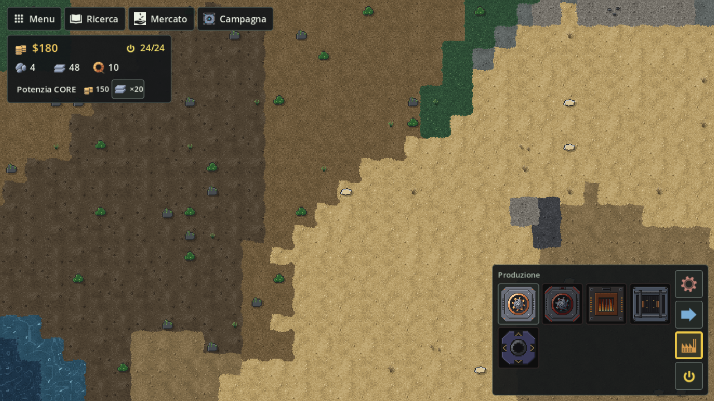

# Campagna e mappe

I dieci livelli della campagna con i loro obiettivi, le mappe, i biomi e la partita libera.

## La campagna

`G` (o **Campagna** dalla Home o dall'HUD) apre l'elenco dei livelli: ogni livello è **BLOCCATO**, **GIOCA** o **COMPLETATO**. Completare un livello sblocca il successivo. Gli obiettivi del livello in corso compaiono in alto a sinistra (`OBIETTIVO`); quando li completi tutti un avviso dice "Livello completato".

Ogni livello parte con soldi e materiali propri e con la Ricerca da capo (solo Nastro T1 e Minatore T1 sbloccati). Le mappe sono prestabilite e crescono con la campagna. Dal livello 4 lo smontaggio rimborsa solo il 50% (vedi [Costruzione](Costruzione)). Ogni livello sceglie il suo tempo (`dayNight` in `data/campaign.json`: `ciclo`, `giorno` o `notte`): i livelli 1–3 sono sempre di giorno, così si impara in pace; i livelli 6 e 10 sono sempre di notte; gli altri seguono il ciclo di giorno e notte.

| # | Livello | Mappa | Biomi | Partenza | Rimborso | Obiettivi |
|---|---|---|---|---|---|---|
| 1 | Primi passi | 200×200 | rocce, prati | $220, 8 Ferro grezzo, 60 Lastre di ferro, 8 Fili di rame | 100% | Vendi 3 ferro grezzo; Guadagna $24 dalle vendite |
| 2 | Prima fabbrica | 250×250 | rocce, prati | $180, 10 Ferro grezzo, 48 Lastre di ferro, 10 Fili di rame | 100% | Magazzino 12 ferro grezzo |
| 3 | Lastre di ferro | 300×300 | rocce, prati | $1.530, 20 Ferro grezzo, 40 Lastre di ferro, 12 Fili di rame | 100% | Sblocca il forno; Magazzino 12 lastre di ferro |
| 4 | Fili di rame | 350×350 | rocce, sabbia, prati | $56.500, 20 Ferro grezzo, 114 Lastre di ferro, 6 Fili di rame | 50% | Sblocca l'assemblatore; Magazzino 4 fili di rame; Vendi 2 fili di rame |
| 5 | Economia Foundry | 400×400 | rocce, sabbia, prati | $1.500, 20 Ferro grezzo, 30 Lastre di ferro, 8 Fili di rame | 50% | Guadagna $150 dalle vendite; Magazzino 40 lastre |
| 6 | Corrente (notte) | 500×500 | rocce, sabbia, prati | $13.830, 20 Ferro grezzo, 56 Lastre di ferro, 16 Fili di rame, 24 Carbone | 50% | Sblocca il generatore; Sblocca il Nodo T1; Magazzino 16 carbone |
| 7 | Venatura di piombo | 600×600 | rocce, sabbia, prati | $1.570, 20 Ferro grezzo, 50 Lastre di ferro, 12 Fili di rame, 18 Carbone | 50% | Magazzino 10 piombo grezzo; Magazzino 6 lastre di piombo |
| 8 | Logistica selettiva | 700×700 | rocce, sabbia, prati | $79.940, 20 Ferro grezzo, 50 Lastre di ferro, 16 Fili di rame | 50% | Sblocca l'incrocio; Sblocca il selezionatore; Magazzino 28 lastre di ferro |
| 9 | Titanio raro | 850×850 | rocce, sabbia, neve, prati | $206.500, 20 Ferro grezzo, 234 Lastre di ferro, 46 Fili di rame, 30 Carbone, 8 Lastre di piombo | 50% | Magazzino 6 titanio grezzo; Magazzino 3 lastre di titanio; Magazzino 4 silicio |
| 10 | Espansione T2 (notte) | 1000×1000 | rocce, sabbia, neve, prati | $279.500, 20 Ferro grezzo, 216 Lastre di ferro, 40 Fili di rame, 20 Carbone, 6 Lastre di piombo | 50% | Sblocca il Minatore T2; Sblocca il Nastro T2; Guadagna $400 dalle vendite; Magazzino 8 grafite |

Soldi e materiali di partenza dei livelli 3–10 sono stati alzati a novembre 2026, quando la Ricerca è stata riscalata per circa 6 ore di partita (vedi [Economia e Ricerca](Economia-e-Ricerca#quanto-costa-tutto-circa-6-ore)): ogni livello parte con almeno quello che costano gli sblocchi che gli servono, compresi il forno e l'assemblatore delle ricette chieste dagli obiettivi, con lo stesso margine di prima. Nel livello 5 l'obiettivo di magazzino è salito a 40 lastre, perché le 30 di partenza servono a sbloccare il forno. Nei livelli 3, 4 e 8 un obiettivo di magazzino è già fatto alla partenza: resta così finché la campagna non si rifà con i numeri nuovi.

Tipi di obiettivo:

| Obiettivo | Cosa chiede |
|---|---|
| Vendi N … | Vendere N pezzi di quell'oggetto |
| Guadagna $N dalle vendite | Incassare N dollari vendendo |
| Magazzino N … | Avere N pezzi di quell'oggetto nel CORE |
| Sblocca … | Sbloccare quel blocco nella Ricerca |

Il titanio compare sulle mappe solo dal livello 9, dove serve il Minatore T2.

### Premi dei capitoli

Quattro nodi della Ricerca sono il **premio di un capitolo** della campagna: capitolo 1 il Generatore a combustione, capitolo 2 il Nastro a pacchi, capitolo 3 la Ricetta dei circuiti, capitolo 4 il **Drone potenziato** (il livello 2 dei quattro potenziamenti del drone insieme). In campagna non si comprano: in Ricerca hanno il numero del capitolo nell'angolo e un bordo di un colore loro, il pannello dice «Premio del capitolo N» e lo sblocco è rifiutato con «Si ottiene chiudendo il capitolo N della campagna». Si ottengono **chiudendo il capitolo**, gratis: la simulazione ha già il modo di darli (`Factory.GrantCampaignReward`), ma a chiamarlo sarà il lancio della **campagna rifatta** ([specifica](https://github.com/Juan0177/tIndustry/blob/main/docs/superpowers/specs/2026-11-09-campagna-rifatta-design.md)), il prossimo lavoro sulla campagna. I dieci livelli di oggi non hanno capitoli, quindi lì i quattro nodi restano bloccati; nessun obiettivo li chiede. Nella partita libera si comprano al triplo del prezzo del foglio (vedi [Economia e Ricerca](Economia-e-Ricerca#i-premi-della-campagna)).

## Partita libera

**Nuova partita** dalla Home genera una mappa dal **seme**:

| Misura | Lato |
|---|---|
| Media | 1000×1000 |
| Grande | 1500×1500 |
| Enorme | 2000×2000 |

Il seme è già compilato con un numero casuale: puoi cambiarlo (un intero tra -2147483648 e 2147483647), sceglierne un altro con **Nuovo seme** o copiarlo con **Copia**. Lo stesso seme con la stessa misura dà sempre la stessa mappa. Il tempo si sceglie con due caselle che si escludono: **Solo giorno (Pacifica)** (sempre giorno, nessun attacco mai) e **Solo notte** (sempre buio, con 10 minuti dal primo blocco al primo attacco); senza spunte il mondo segue il ciclo, con il giorno di 10 minuti e la notte di 4, alba e tramonto di 20 secondi compresi. Il tempo parte dal primo blocco piazzato. **Inizia** (o Invio) avvia, **Indietro** (o Esc) torna alla Home. Per Grande ed Enorme compare "Generazione della mappa…" per qualche secondo.

Si parte con $180, 48 Ferro grezzo, 48 Lastre di ferro e 10 Fili di rame, e lo smontaggio rimborsa il 100%.

## Mappe e biomi

| Bioma | Suoli | Pareti |
|---|---|---|
| Rocce | pietra, basalto, ghiaia | parete di roccia |
| Sabbia | sabbia, sabbia scura | parete di sabbia |
| Neve | neve, ghiaccio | parete di ghiaccio |
| Prati | erba, muschio, fango, terra | parete di arbusti |

In ogni bioma possono esserci laghi e fiumi: **acqua bassa** sulle rive (si costruisce) e **acqua profonda** al centro (non si costruisce, i nastri non la attraversano, il ponte la scavalca). Sulle **pareti** non si costruisce nulla. Il drone vola sopra tutto.

Il CORE parte al centro, in un'area libera con ferro e rame vicini e una strada a terra verso ferro, rame e carbone. I giacimenti sono ferro, rame, carbone, piombo e titanio (vedi [Risorse e oggetti](Risorse-e-oggetti)).

## Vedi anche

- [Primi passi](Primi-passi)
- [Economia e Ricerca](Economia-e-Ricerca)
- [Salvataggi](Salvataggi)

<!-- navigazione: generata da tools/dev/wiki_navigazione.py -->

---

[← Pagina precedente: Economia e Ricerca](Economia-e-Ricerca) · [Torna alla Home](Home) · [Pagina successiva: Impostazioni e accessibilità →](Impostazioni-e-accessibilita)

<!-- /navigazione -->
