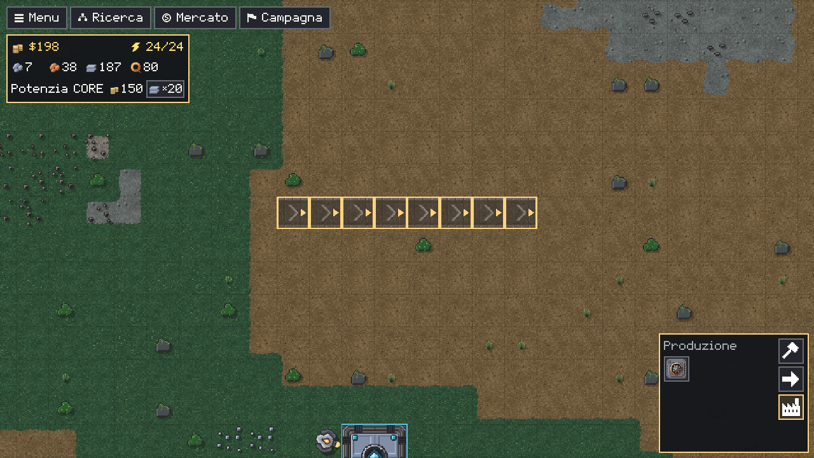

# Comandi

Tutti i controlli di mouse e tastiera, come in Mindustry: **il drone sei tu**. Lo muovi con `WASD`, la visuale lo segue, e non ci sono strumenti da cambiare: un clic fa quello che ha senso in quel punto.

## Muovere il drone e la visuale

| Comando | Effetto |
|---|---|
| `W` `A` `S` `D` | Muovono il drone (in diagonale la velocità non aumenta); il drone vola sopra tutto e non esce dalla mappa |
| Tasto centrale tenuto e trascinato | Sposta la visuale lontano dal drone; al rilascio torna sul drone |
| `H` (o `Home`) | Rimette subito la visuale sul drone |
| Rotellina | Zoom (se hai scelto un blocco orientabile, lo ruota: vedi sotto; con `Ctrl` zooma sempre) |
| Clic sul riquadro della coda (in alto a sinistra) | Porta la visuale sul cantiere in lavorazione |

La visuale insegue il drone con un leggero ritardo. Mentre un pannello copre la partita (Ricerca, Mercato, Campagna, Impostazioni) il drone sta fermo; il tasto tenuto vale di nuovo appena il pannello si chiude.

## Senza un blocco scelto

Non c'è più il cursore da attivare: se non hai un blocco in mano, il clic sinistro è questo.

| Azione | Effetto |
|---|---|
| Clic su un blocco | Lo seleziona: le informazioni sono quelle del suggerimento al passaggio del mouse. Se ha una configurazione, la apre: il filtro di selezionatori ed estrattori (icone degli oggetti e **Nessuno**; `Esc` lo chiude) o i laser di un nodo (poi clic su un blocco di corrente per collegarlo o scollegarlo) |
| Clic **tenuto** su un giacimento | Il drone scava a mano finché il tasto è giù (vedi [Produzione](Produzione#scavo-a-mano)) |
| Clic destro, o trascinato | Cancella un piano o smonta (vedi sotto) |
| `Q` | Sceglie il blocco (o il cantiere) sotto il cursore, con la sua direzione; usa il tasto fisico, quindi sta nello stesso punto anche su una tastiera AZERTY |

## Scegliere un blocco

La palette sta in basso a destra: a destra le categorie (Logistica, Produzione, Potenza, Magazzino), a sinistra una griglia di icone. Mostra solo i blocchi già sbloccati nella [Ricerca](Economia-e-Ricerca); passando sopra un'icona compaiono nome, tasto rapido e costi (barrati se mancano), e `?` apre il dettaglio. Un clic su un'icona sceglie il blocco.

| Tasto | Blocco |
|---|---|
| `1` (o `N`) | Nastro T1 |
| `2` | Minatore T1 |
| `3` (o `F`) | Forno |
| `4` | Assemblatore |
| `5` (o `J`) | Incrocio |
| `6` | Router |
| `7` | Generatore |
| `8` | Selezionatore |
| `9` | Nastro ponte |
| `Esc`, `` ` `` o clic destro | Deseleziona il blocco |

Gli altri blocchi (Nastro T2, Nastro T3, Nastro rinforzato, Minatore T2, Estrattore, Nodi, Lampada, magazzini) si scelgono dalla palette. Un tasto di un blocco non ancora sbloccato dà un avviso.

## Piazzare

Con un blocco scelto, il clic sinistro piazza. Il drone costruisce solo i piani **entro il suo raggio** (27,5 celle): quelli più lontani restano in coda, semitrasparenti con un contorno «fuori raggio», e partono quando ti avvicini (vedi [Costruzione](Costruzione)).

| Azione | Effetto |
|---|---|
| Clic sinistro | Pianifica il blocco nella cella |
| Trascina col sinistro | Mostra l'anteprima dall'ancora al cursore; i piani partono tutti al **rilascio** |
| `R` | Ruota il blocco in mano |
| Rotellina, con un blocco orientabile in mano | Ruota come `R` (su in senso orario, giù al contrario); senza un blocco orientabile zooma |
| `R` o rotellina **durante** il trascinamento | Fissa quella direzione per tutta la linea (una fila "di lato") |
| `Ctrl` durante il trascinamento (nastri) | Segue la catena di nastri esistente o fa un percorso a scalini attorno agli ostacoli |
| `Esc` o destro durante il trascinamento | Annulla la linea (il blocco resta in mano) |

Sono orientabili: nastri, ponte, assemblatore. Incrocio, router, selezionatori ed estrattore non hanno direzione: `R` e la rotellina non li girano. Il filtro non si sceglie con un tasto ma col clic sul blocco già piazzato, senza blocco in mano.

**Come si comporta il trascinamento.** Nastri, incroci, router e selezionatori fanno una retta lungo l'asse più lungo fra orizzontale e verticale; ogni altro blocco è uno solo, sull'ancora, girato verso il cursore. Ogni nastro guarda il successivo; l'ultimo prende la direzione del nastro su cui finisce e, accanto al CORE, guarda il CORE. Le sagome rosse sono celle rifiutate: non partono. Anche un pannello che si apre, la finestra che perde il fuoco o un rilascio fuori dalla finestra annullano la linea senza piazzare nulla.

## Smontare e annullare

| Azione | Effetto |
|---|---|
| Clic destro su un piano | Lo cancella (anche se è fuori raggio) |
| Clic destro su un cantiere | Lo annulla: il drone restituisce quanto speso |
| Clic destro su un blocco o un nastro | Lo segna in rosso per lo smontaggio; un secondo clic toglie il segno |
| Trascina col destro | Rettangolo rosso (al massimo 64 celle per lato): al rilascio segna tutti i blocchi dentro e cancella piani e cantieri; non toglie mai un segno |

Il clic destro **senza** blocco in mano smonta; con un blocco in mano lo deseleziona (e durante un trascinamento annulla la linea).

## Pannelli e partita

| Tasto | Effetto |
|---|---|
| `T` | Ricerca (dentro: trascina per muoverti, rotellina per lo zoom, `H` vista intera, frecce per passare da un blocco all'altro, `T` o `Esc` chiude) |
| `M` | Mercato (`M` o `Esc` chiude) |
| `G` | Campagna, scelta del livello (`G` o `Esc` chiude) |
| `I` | Impostazioni |
| `Esc` senza blocco in mano | Salva la Continua e apre la Home; la partita si ferma finché non premi **Riprendi** (o di nuovo `Esc`) |
| `F5` / `F9` | Salva / carica la Continua |
| `F6` / `F7` | Salva / carica lo slot rapido `slot-1` |
| `Spazio` | Mette in pausa la partita o la riprende; al centro compare «In pausa». I comandi dati in pausa (piazzare, smontare, vendere…) partono alla ripresa |
| `F1` `F2` `F3` `F4` | Solo con `TINDUSTRY_DEV=1`: velocità ×1 / ×5 / ×10 / ×20 |

`Spazio` non funziona nei menu (Home, Nuova partita, salvataggi, Impostazioni, Campagna) né mentre scrivi in un campo di testo; la partita si ferma anche mentre la Home è aperta. Ricerca, Mercato e Campagna si aprono anche dai pulsanti in alto a sinistra (**Menu · Ricerca · Mercato · Campagna**). Il Mercato è sempre `M`: non c'è una mappa grande.

**Tutorial**: `Invio` passa al passo successivo, `Backspace` lo salta.
**Gestione salvataggi**: frecce su e giù per scegliere, `Invio` per caricare.

## Vedi anche

- [Costruzione](Costruzione)
- [Logistica](Logistica)
- [Primi passi](Primi-passi)

<!-- navigazione: generata da tools/dev/wiki_navigazione.py -->

---

[← Pagina precedente: Primi passi](Primi-passi) · [Torna alla Home](Home) · [Pagina successiva: Risorse e oggetti →](Risorse-e-oggetti)

<!-- /navigazione -->
