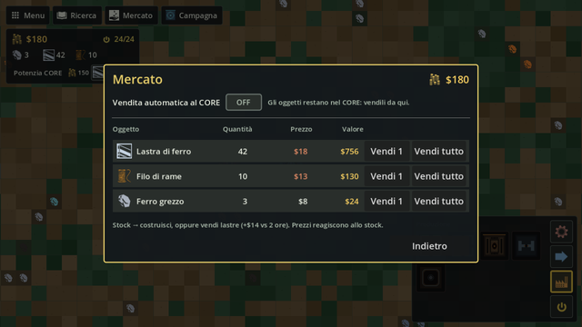
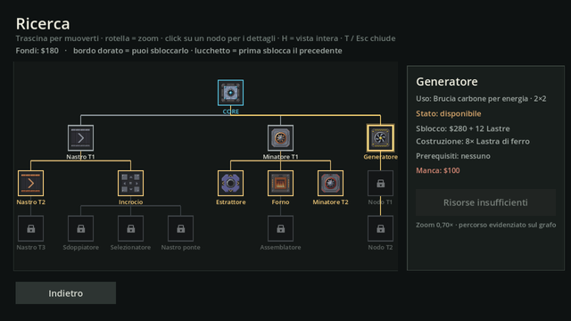

# Economia e Ricerca

Il CORE e il suo magazzino, il Mercato con i suoi prezzi e l'albero della Ricerca con tutti gli sblocchi e i loro costi.

## Il CORE

Il CORE è il cuore della base: tutto quello che vi arriva sui nastri, o da un edificio che lo tocca, entra nel suo **magazzino**. Dal magazzino si pagano costruzioni e sblocchi. Il CORE non vende da solo: per guadagnare si vende al Mercato (o si accende la vendita automatica).

Il pannello in alto a sinistra mostra i **Fondi** (`$`), l'energia e gli oggetti che hai, ognuno con il massimo (`120/1.000`; passa col mouse per il nome). Un oggetto al massimo si vede pieno, col colore di avviso.

### Il magazzino ha un massimo

Ogni oggetto ha un **massimo**, che dipende dal livello del CORE. I soldi non hanno limite. Quando un oggetto è al massimo il CORE non lo accetta più: il nastro che lo porta si ferma e si riempie dietro, un minatore attaccato smette di consegnarlo, e riparte appena il magazzino scende sotto il massimo. Gli altri oggetti arrivano normalmente. I rimborsi (smontaggio, cantiere annullato) entrano fino al massimo: il resto va perso.

### I tre livelli

Si parte sempre dallo **shard**. Gli altri due si sbloccano nella Ricerca (ramo **CORE**, sotto la radice) e si piazzano sopra il CORE vecchio.

| CORE | Misura | Massimo per oggetto | Vendita automatica | Drone | Ricerca | Costruzione |
|---|---|---|---|---|---|---|
| shard | 3×3 | 1.000 | 10 pezzi/s | alpha | di partenza | — |
| foundation (`core-foundation`) | 4×4 | 4.000 | 25 pezzi/s | beta | $1.500.000, 800 Lastre di ferro, 400 Fili di rame | 800 Lastre di ferro, 500 Fili di rame, 400 Lastre di piombo |
| nucleus (`core-nucleus`) | 5×5 | 12.000 | 60 pezzi/s | gamma | $7.000.000, 2.400 Lastre di titanio, 1.800 Silicio | 3.000 Lastre di ferro, 2.000 Lastre di piombo, 1.500 Silicio, 1.000 Lastre di titanio |

Il nucleus si sblocca dopo il foundation. Non c'è più il pulsante «Potenzia CORE»: sbloccato il livello, il blocco compare nella palette (categoria **Magazzino**).

**Come si potenzia.** Il blocco si piazza solo sopra il CORE attuale: il fantasma si aggancia lì e non va altrove. Lo shard 3×3 cresce di una fila a destra e in basso (diventa foundation 4×4 con lo stesso angolo in alto a sinistra); il foundation cresce di una fila a sinistra e in alto (diventa nucleus 5×5, centrato come lo shard di partenza). Le celle nuove devono essere **libere e costruibili**: niente edifici, nastri, cantieri, pareti, acqua profonda, né il bordo della mappa; se no il piazzamento è rifiutato col motivo. Un magazzino collegato o lo [schermo di borsa](#lo-schermo-di-borsa) sulla fila di crescita vanno spostati prima, come ogni altro edificio (in Mindustry è lo stesso): conviene attaccarli dove il CORE non cresce. Lo shard cresce a destra e in basso e il foundation a sinistra e in alto, quindi nessun lato resta libero da tutti e due i potenziamenti: chi li fa entrambi sposta qualcosa una volta. È un cantiere del drone come gli altri: i materiali escono dal magazzino a poco a poco, intanto il CORE vecchio lavora normalmente. Annullarlo rende tutto lo speso. Un solo potenziamento alla volta, e il CORE non scende di livello.

**Il drone.** A potenziamento finito il drone passa al tipo successivo: più veloce a costruire e a volare, stesso raggio (vedi [Costruzione](Costruzione)).

### Container e vault

| Blocco | Misura | Spazio per oggetto | Ricerca | Costruzione |
|---|---|---|---|---|
| Contenitore (`container`) | 2×2 | 300 | $110.000, 60 Lastre di ferro, 30 Lastre di piombo (dopo l'Incrocio) | 40 Lastre di ferro, 20 Lastre di piombo |
| Deposito (`vault`) | 3×3 | 1.000 | $1.500.000, 80 Lastre di titanio (dopo il Contenitore) | 60 Lastre di titanio, 40 Lastre di ferro |

Un magazzino che **tocca il CORE** (lato contro lato) è *collegato*: il suo spazio si somma al massimo di ogni oggetto e fa parte del magazzino del CORE (vendite, «Vendi tutto» e costruzioni vedono un magazzino solo). Uno che non lo tocca è un **deposito a sé**, con un contenuto suo per oggetto: accetta da nastri ed edifici qualsiasi oggetto finché c'è posto, e l'estrattore attaccato lo svuota. Smontarlo perde il contenuto (il rimborso dei materiali è quello normale). Se il CORE cresce fino a toccare un deposito a sé, questo versa il suo contenuto nel CORE fino al massimo. Se smonti un magazzino collegato e il massimo scende sotto quanto c'è, niente sparisce: l'oggetto resta «pieno» finché non scende sotto il nuovo massimo.

## Il Mercato

`M` apre il Mercato, una panoramica: una riga per ogni oggetto che hai nel CORE, con quantità, prezzo del momento con la freccia (su o giù), un mini grafico degli ultimi 2 minuti, i pulsanti **Vendi 1**, **Vendi 100** e **Vendi tutto**, l'interruttore della vendita automatica di quell'oggetto e la spunta «solo a CORE pieno». La quantità si legge `x/massimo`. Non c'è un pulsante che vende tutto di tutti. Se un oggetto è in crollo la riga lo dice. Una spiegazione senza numeri è in [Mercato come una borsa](Mercato-come-una-borsa).

Ogni oggetto ha un mercato suo, come un titolo in borsa, con un **valore base** B che è anche il prezzo minimo: sotto B il prezzo non scende (salvo il crollo, sotto). Tutti i pezzi di una vendita valgono il prezzo del momento del clic.

### Come si muove il prezzo

- **Normale.** Fra B e 1,6×B, con una media di 1,3×B: un passo nuovo ogni 4 secondi, un richiamo verso la media e un piccolo scarto casuale.
- **Picco.** Per ogni oggetto, ogni 10-20 minuti: sale in 10 secondi fino a un massimo fra 2,8×B e 3×B, resta in cima 10 secondi e scende in 30. Da 2,8×B si dice che la vendita è «nel picco».
- **Vendite.** Ogni pezzo venduto abbassa il prezzo dello 0,04% di B, mai sotto B. In 2 minuti il prezzo torna al suo andamento.
- **Crollo.** Se in 2 minuti vendi 5.000 pezzi o più di un oggetto, quell'oggetto crolla per 20 minuti: prezzo vicino a B, nei primi 5 minuti a volte 0,6-0,7×B per 10 secondi, e niente picchi. Gli altri oggetti non cambiano.
- **Vendita automatica.** Un interruttore per oggetto. Vende **dal magazzino** al **prezzo minimo** (B, o il prezzo del momento se è sotto B in un crollo), con il ritmo del CORE: 10, 25 o 60 pezzi al secondo per oggetto (shard, foundation, nucleus). Non tocca il mercato: niente calo, niente crollo, niente picchi. Se la produzione supera il ritmo il magazzino sale fino al massimo e la linea si ferma. Accanto all'interruttore c'è la spunta **«solo a CORE pieno»**: l'oggetto si vende solo mentre è al massimo o a meno di un secondo di vendita dal massimo (massimo meno il ritmo), così il magazzino resta pieno, pronto per un picco, e la linea scorre fino al ritmo.
- **Jackpot.** Con **Vendi tutto**, nel picco, con almeno 400 pezzi e con lo [schermo di borsa](#lo-schermo-di-borsa) attivo, una vendita può valere circa dieci volte (probabilità dal 2% al 50% secondo i pezzi, con una «rete di sicurezza» che garantisce la vittoria dopo tre tentativi grossi a vuoto). Senza schermo attivo il «Vendi tutto» non tenta il jackpot. Vedi anche [Mercato come una borsa](Mercato-come-una-borsa).

### Valori base

| Oggetto | B | Normale (B - 1,6×B) | Picco massimo (3×B) |
|---|---|---|---|
| Ferro grezzo (`iron-ore`) | $6 | $6 - $9,6 | $18 |
| Lastra di ferro (`iron-plate`) | $23 | $23 - $36,8 | $69 |
| Rame grezzo (`copper-ore`) | $5 | $5 - $8 | $15 |
| Filo di rame (`copper-wire`) | $12 | $12 - $19,2 | $36 |
| Carbone (`coal`) | $3 | $3 - $4,8 | $9 |
| Piombo grezzo (`lead-ore`) | $4 | $4 - $6,4 | $12 |
| Lastra di piombo (`lead-plate`) | $14 | $14 - $22,4 | $42 |
| Titanio grezzo (`titanium-ore`) | $14 | $14 - $22,4 | $42 |
| Lastra di titanio (`titanium-plate`) | $52 | $52 - $83,2 | $156 |
| Grafite (`graphite`) | $12 | $12 - $19,2 | $36 |
| Silicio (`silicon`) | $32 | $32 - $51,2 | $96 |
| Sabbia (`sand`) | $2 | $2 - $3,2 | $6 |
| Vetro (`glass`) | $9 | $9 - $14,4 | $27 |
| Plastica (`plastic`) | $20 | $20 - $32 | $60 |
| Circuito (`circuit`) | $90 | $90 - $144 | $270 |

Il prezzo è sempre un numero intero di dollari quando paga: gli oggetti da pochi dollari cambiano prezzo in dollari di rado (il carbone solo una decina di volte in un quarto d'ora), quelli cari di continuo. Trasformare conviene: una Lastra di ferro vale $23, i due Ferro grezzo che servono per farla $12.

### Lo schermo di borsa

| Blocco | Misura | Ricerca | Costruzione |
|---|---|---|---|
| Schermo di borsa (`market-screen`) | 2×2 | $150.000, 240 Lastre di ferro, 120 Fili di rame (dopo l'Assemblatore) | 60 Lastre di ferro, 25 Fili di rame, 10 Lastre di piombo |

Uno solo per partita (finito, in cantiere o in piano), senza direzione e senza corrente, nella categoria **Magazzino** della palette. Si piazza solo se una sua cella tocca **lato contro lato** il CORE (se no: «Lo schermo di borsa va messo a contatto col CORE»; un secondo: «C'è già uno schermo di borsa: se ne può avere uno solo»). È **attivo** quando è finito e tocca il CORE: solo allora il «Vendi tutto» può tentare il jackpot e si vedono i moduli. «Staccato dal CORE» è solo uno stato di sicurezza (il CORE non può allargarsi sullo schermo); smontato e ripiazzato a contatto torna attivo. Sulle celle dove il CORE si allarga **blocca il potenziamento** come ogni edificio (vedi [Come si potenzia](#i-tre-livelli)).

- **Oggetto seguito.** Clic sullo schermo senza blocco scelto: la scheda «Oggetto seguito · Schermo di borsa» offre gli oggetti del Mercato e **Nessuno**. Sul vetro: icona, prezzo con ▲▼, grafico degli ultimi 2 minuti (gli stessi dati della panoramica) e «Crollo» se l'oggetto è crollato; senza oggetto «Scegli un oggetto». Il suggerimento al passaggio del mouse ripete tutto per esteso.
- **Esito del «Vendi tutto».** Per 6 secondi (360 tick) dopo ogni «Vendi tutto» fatto con lo schermo attivo: oggetto venduto, incasso «+$N» e i LED della cornice. «Vendi 1», «Vendi 100» e la vendita automatica non accendono niente.

| LED | Quando (`marketRules`) |
|---|---|
| Giallo | «Vendi tutto» da `ledYellowPieces` = 10.000 pezzi in su (il 50/50), vinto o perso; sempre col jackpot, che aggiunge «JACKPOT» e le luci lampeggianti negli angoli |
| Blu | sotto i 10.000 pezzi, senza crollo, e il prezzo è sceso al massimo di `ledMildDrop` = 10% di B |
| Viola | tutti gli altri: calo oltre il 10% di B, oppure l'oggetto crolla o era già in crollo |

I colori dei LED cambiano con la variante **Colori** (Normali, Daltonici, Alto contrasto).

### I moduli della Finanza

Tre nodi della Ricerca in fila dopo lo schermo. Non si piazzano: sbloccati, si vedono sul vetro (per l'oggetto seguito) e nella panoramica del Mercato (riga «Moduli» di ogni oggetto), **solo con lo schermo attivo**.

| Modulo | Cosa mostra |
|---|---|
| Previsione (`finance-forecast`) | Nello stato normale «picco fra circa N min» (minuti per eccesso, «meno di 1 min» sotto i 60 s) e «aspetta»; all'inizio della salita «picco in arrivo»; dalla soglia del picco (2,8×B) «vendi ora»; nel crollo «fine del crollo fra N min»; dopo un tentativo a vuoto «Vendi tutto bloccato per N min». Non prevede mai il jackpot |
| Percentuale (`finance-percent`) | Il prezzo del momento come «+N% su B», intero per difetto (negativo nel tuffo del crollo) |
| Probabilità (`finance-odds`) | La probabilità del jackpot se ora si facesse «Vendi tutto» di tutti i pezzi di quell'oggetto, rete di sicurezza compresa, calcolata con la stessa regola della vendita: 0% fuori dal picco, sotto i 400 pezzi o durante l'attesa |

## La Ricerca

`T` apre la Ricerca, un albero come in Mindustry con il CORE in cima e ogni blocco sotto il suo prerequisito. Bordo dorato: puoi sbloccarlo ora. Lucchetto: prima sblocca il precedente. Passa col mouse per costo e mancanze, fai clic per il pannello di sblocco e **Conferma sblocco**. Trascina per muoverti, rotellina per lo zoom, `H` per la vista intera.

Sbloccare costa **soldi e materiali**, presi dal CORE; poi il blocco compare nella palette e si costruisce pagando il suo costo di costruzione (vedi [Produzione](Produzione) e [Logistica](Logistica)).

| Blocco | Ramo | Prerequisito | Costo di sblocco |
|---|---|---|---|
| Nastro T1 (`conveyor-basic`) | Logistica | — | iniziale |
| Incrocio (`junction`) | Logistica | Nastro T1 | $6.900, 26 Ferro grezzo |
| Router (`router`) | Logistica | Incrocio | $9.700, 26 Ferro grezzo |
| Selezionatore (`sorter`) | Logistica | Incrocio | $73.000, 30 Ferro grezzo, 30 Piombo grezzo |
| Selezionatore invertito (`sorter-inverted`) | Logistica | Selezionatore | $73.000, 30 Ferro grezzo, 30 Piombo grezzo |
| Nastro ponte (`conveyor-bridge`) | Logistica | Incrocio | $91.000, 63 Ferro grezzo, 63 Piombo grezzo |
| Nastro T2 (`conveyor-fast`) | Logistica | Nastro T1 | $73.000, 24 Ferro grezzo, 24 Piombo grezzo, 24 Titanio grezzo |
| Nastro rinforzato (`conveyor-armored`) | Logistica | Nastro T2 | $1.300.000, 32 Ferro grezzo, 32 Piombo grezzo, 40 Titanio grezzo, 32 Grafite |
| Nastro T3 (`conveyor-express`) | Logistica | Nastro T2 | $1.500.000, 32 Titanio grezzo, 32 Silicio, 32 Grafite |
| Contenitore (`container`) | Logistica | Incrocio | $110.000, 60 Lastre di ferro, 30 Lastre di piombo |
| Deposito (`vault`) | Logistica | Contenitore | $1.500.000, 80 Lastre di titanio |
| CORE foundation (`core-foundation`) | CORE | CORE | $1.500.000, 800 Lastre di ferro, 400 Fili di rame |
| CORE nucleus (`core-nucleus`) | CORE | CORE foundation | $7.000.000, 2.400 Lastre di titanio, 1.800 Silicio |
| Minatore T1 (`miner`) | Produzione | — | iniziale |
| Estrattore (`extractor`) | Produzione | Minatore T1 | $2.800, 12 Lastre di ferro |
| Forno (`smelter`) | Produzione | Minatore T1 | $1.500, 30 Lastre di ferro |
| Assemblatore (`assembler`) | Produzione | Forno | $55.000, 66 Lastre di ferro, 12 Rame grezzo |
| Minatore T2 (`miner-advanced`) | Produzione | Minatore T1 | $150.000, 120 Lastre di ferro, 24 Fili di rame |
| Trapano a impatto (`impact-drill`) | Produzione | Minatore T2 | $720.000, 360 Lastre di titanio, 240 Silicio |
| Pressa grande (`graphite-press`) | Produzione | Assemblatore | $64.000, 60 Lastre di ferro, 30 Lastre di piombo |
| Plastificatore (`plasticizer`) | Produzione | Pressa grande | $360.000, 120 Silicio, 120 Grafite |
| Ricetta dei circuiti (`circuit`) | Produzione | Assemblatore | $480.000, 160 Silicio, 160 Lastre di piombo |
| Fonderia avanzata (`smelter-advanced`) | Produzione | Forno | $360.000, 160 Lastre di titanio, 80 Fili di rame |
| Separatore (`separator`) | Produzione | Fonderia avanzata | $390.000, 160 Lastre di titanio, 80 Grafite |
| Generatore (`generator`) | Energia | — | $5.500, 24 Lastre di ferro |
| Nodo T1 (`power-node`) | Energia | Generatore | $8.300, 8 Lastre di ferro, 4 Fili di rame |
| Lampada (`lamp`) | Energia | Nodo T1 | $11.000, 8 Lastre di ferro, 4 Fili di rame |
| Batteria (`battery`) | Energia | Nodo T1 | $91.000, 30 Lastre di piombo, 15 Fili di rame |
| Nodo T2 (`power-node-t2`) | Energia | Nodo T1 | $910.000, 48 Lastre di ferro, 24 Fili di rame |
| Schermo di borsa (`market-screen`) | Finanza | Assemblatore | $150.000, 240 Lastre di ferro, 120 Fili di rame |
| Modulo previsione (`finance-forecast`) | Finanza | Schermo di borsa | $2.000.000, 240 Lastre di piombo, 120 Fili di rame |
| Modulo percentuale (`finance-percent`) | Finanza | Modulo previsione | $2.400.000, 320 Lastre di titanio |
| Modulo probabilità (`finance-odds`) | Finanza | Modulo percentuale | $4.000.000, 720 Silicio, 480 Grafite |

La **Ricetta dei circuiti** è un nodo di tipo ricetta: non dà un blocco da piazzare ma insegna all'Assemblatore il Circuito (anche a quelli già costruiti). Gli sblocchi valgono per la partita in corso e si salvano con lei. Ogni livello della campagna riparte con i soli Nastro T1 e Minatore T1.

### Quanto costa tutto: circa 6 ore

I costi di sblocco non si scelgono a mano: li calcola il foglio «Bilanciamento» di `tools/dev/genera_finanza.py`, che li scrive in `data/content.json` (`--scrivi-costi`) e controlla che siano ancora quelli (`--controlla`). L'idea è che sbloccare **tutta la Ricerca** (in tutto **$25.395.700**) richieda **circa 6 ore** di partita ben giocata senza jackpot, vendendo il prodotto migliore di ogni fase e non il ferro grezzo. Il foglio dà **6,38 ore** senza jackpot, 5,92 con un jackpot e 5,71 con due. I sei nodi della Ricerca allargata (piano 1) hanno alzato il conto da 5,86 ore: il riequilibrio vero è del piano 3 (potenziamenti, premi e bilanciamento).

| Fase | Orario | Prodotti venduti (al secondo) | Incasso a B |
|---|---|---|---|
| Inizio | 0–30 min | 2 Lastre di ferro | $46/s |
| Metà | 30 min – 2 h | 10 Fili di rame, 8 Lastre di piombo, 6 Grafite | $304/s |
| Avanzata | 2–4 h | 12 Lastre di titanio, 12 Silicio | $1.008/s |
| Fine | 4–6 h | 36 Lastre di titanio, 35 Silicio | $2.992/s |

Il costo in soldi di un nodo è l'incasso della sua fase per i minuti di lavoro che gli dà il foglio, arrotondato a due cifre; i materiali sono quelli di prima moltiplicati per la fase (×2, ×3, ×4, ×6), così una fase non si salta vendendo. I nodi: **Inizio** estrattore, forno, incrocio, router, generatore, Nodo T1, lampada; **Metà** assemblatore, pressa grande, selezionatori, ponte, Nastro T2, batteria, contenitore, Minatore T2, schermo di borsa; **Avanzata** Nodo T2, fonderia avanzata, separatore, plastificatore, ricetta dei circuiti, deposito, nastri rinforzato e T3, CORE foundation, previsione, percentuale; **Fine** trapano a impatto, CORE nucleus, probabilità.

Due conti a parte:

- Il **jackpot** sul testa o croce di 10.000 Lastre di titanio alla soglia del picco vale **$5.500.000** (la stessa vendita a B ne darebbe 520.000): quasi un CORE nucleus.
- Le fasi non partono sempre all'orario: una fase comincia solo quando la Ricerca di quelle prima è tutta comprata. Senza jackpot la Ricerca dell'Avanzata finisce verso **5 h 18 min**, e lì parte la fase Fine. Con le fasi all'orario in 6 ore si incasserebbero $30.524.400; nella partita del foglio si incassa un po' meno.

Costi di costruzione dei blocchi: invariati. Il foglio ha già una riga «Difesa (aspetto 13)», oggi a zero, per la spesa di torrette e difese quando arriveranno.

## Vedi anche

- [Risorse e oggetti](Risorse-e-oggetti)
- [Campagna e mappe](Campagna-e-mappe)
- [Costruzione](Costruzione)

<!-- navigazione: generata da tools/dev/wiki_navigazione.py -->

---

[← Pagina precedente: Costruzione](Costruzione) · [Torna alla Home](Home) · [Pagina successiva: Campagna e mappe →](Campagna-e-mappe)

<!-- /navigazione -->
