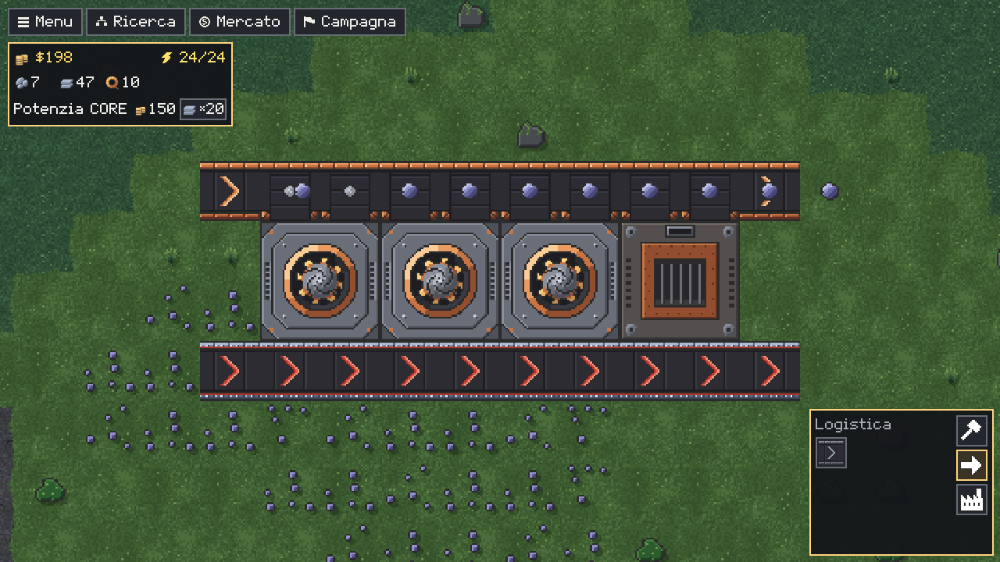

# Logistica

Come si spostano gli oggetti: nastri e loro tier, curve e unioni, incrocio, router, selezionatore, overflow e underflow gate, estrattore, ponte e ponte lungo, nastro rinforzato e nastro a pacchi.

## Nastri

In una cella di nastro stanno fino a **3 oggetti**, a 0,4 di cella l'uno dall'altro; una linea piena porta *velocità ÷ 0,4* oggetti al secondo, uguale in tutte le direzioni.

| Nastro | Velocità (celle/s) | Portata (oggetti/s) | Costo per cella | Sblocco |
|---|---|---|---|---|
| Nastro T1 (`conveyor-basic`) | 2,1 | 5,25 | 1 Ferro grezzo | iniziale |
| Nastro T2 (`conveyor-fast`) | 4,8 | 12 | 1 Ferro grezzo, 1 Piombo grezzo, 1 Titanio grezzo | dopo il Nastro T1 |
| Nastro T3 (`conveyor-express`) | 7,2 | 18 | 1 Titanio grezzo, 1 Silicio, 1 Grafite | dopo il Nastro T2 |
| Nastro rinforzato (`conveyor-armored`) | 4,8 | 12 | 1 Ferro grezzo, 1 Piombo grezzo, 2 Titanio grezzo, 1 Grafite | dopo il Nastro T2 |
| Nastro a pacchi (`conveyor-stack`) | 21,6 | fino a 216 pezzi con più carichi che si uniscono (un solo carico arriva a circa 40–50 pezzi) | 1 Plastica, 1 Silicio, 1 Grafite | dopo il Nastro T3 |

## Pezzi speciali

| Pezzo | Portata | Costo | Sblocco | Cosa fa |
|---|---|---|---|---|
| Incrocio (`junction`) | Coda di 6 oggetti per direzione, 26 tick per attraversarlo: circa 13,8 oggetti/s per direzione | 3 Ferro grezzo | dopo il Nastro T1 | Due linee si attraversano senza mescolarsi; prende anche dagli edifici accanto e accetta un oggetto solo se dall'altra parte c'è un blocco che può riceverlo |
| Router (`router`) | 1 oggetto alla volta, 8 tick ciascuno: 7,5 oggetti/s | 3 Ferro grezzo | dopo l'Incrocio | Distribuisce gli oggetti a turno su tutti i lati, mai verso il lato da cui arrivano |
| Selezionatore (`sorter`) | istantaneo, passa al ritmo del nastro | 2 Ferro grezzo, 2 Piombo grezzo | dopo l'Incrocio | L'oggetto del filtro va dritto, gli altri di lato, alternando |
| Selezionatore invertito (`sorter-inverted`) | istantaneo, passa al ritmo del nastro | 2 Ferro grezzo, 2 Piombo grezzo | dopo il Selezionatore | Il contrario: l'oggetto del filtro di lato, gli altri dritti |
| Overflow gate (`overflow-gate`) | istantaneo, passa al ritmo del nastro | 4 Lastre di piombo, 2 Fili di rame | dopo il Router | Dritto; ai lati, alternando, solo quando davanti non accetta |
| Underflow gate (`underflow-gate`) | istantaneo, passa al ritmo del nastro | 4 Lastre di piombo, 2 Fili di rame | dopo l'Overflow gate | Il contrario: ai lati alternando, dritto solo quando i lati non accettano |
| Estrattore (`extractor`) | 11 oggetti/s | 2 Lastre di ferro | Ricerca | Tira un oggetto fuori da un magazzino o da una macchina e lo dà al blocco accanto |
| Nastro ponte (`conveyor-bridge`) | 5,25 oggetti/s | 6 Ferro grezzo, 6 Piombo grezzo **per estremo** (12 e 12 in tutto) | dopo l'Incrocio | Scavalca da 1 a 3 celle |
| Ponte lungo (`bridge-long`) | 5,25 oggetti/s | 6 Lastre di titanio, 6 Lastre di piombo, 2 Silicio **per estremo** (12, 12 e 4 in tutto) | dopo il Nastro ponte | Scavalca da 1 a 7 celle; consuma 1 di corrente al secondo |

I costi di sblocco sono in [Economia e Ricerca](Economia-e-Ricerca).

I nastri hanno la forma **stretta** di Mindustry (la variante C): il binario occupa solo il mezzo della cella e le curve, le unioni e le T si leggono a colpo d'occhio. Incrocio, router, selezionatori, gate ed estrattore non hanno direzione e non si ruotano con `R`.

## Curve, unioni e T

Un nastro prende oggetti da dietro e dai lati: da altri nastri e dagli edifici che gli scaricano sopra. Non prende mai dal nastro che ha **di fronte** (due nastri testa a testa non si passano nulla).

- Un solo ingresso di lato e niente dietro: il nastro si disegna a **curva**.
- Ingresso dietro e di lato: è un'**unione**, le due linee diventano una.
- Ingressi su entrambi i lati e niente dietro: il nastro si disegna a **T**.

## Nastro sopra nastro

| Cosa piazzi sopra un nastro semplice | Cosa succede |
|---|---|
| Lo stesso nastro, direzione diversa | Il nastro gira subito, gratis, e tiene i suoi oggetti |
| Lo stesso nastro, stessa direzione | Niente |
| Un nastro di un altro tipo (altro tier o il rinforzato) | Lo **sostituisce**: il drone apre un cantiere, paghi solo la **differenza** dei costi, il nastro nuovo tiene gli oggetti del vecchio; se il nastro vecchio costava di più, la parte in più torna al CORE con la quota di rimborso |

Annullare un cambio di tier col destro rimette il nastro vecchio con i suoi oggetti. Per potenziare una catena intera trascina con `Ctrl` dal primo all'ultimo nastro con il nuovo tier in mano: la linea segue la catena e ogni nastro tiene la sua direzione.

## Incrocio

Come la *Junction* di Mindustry: un oggetto che entra da un lato esce dal lato opposto. Ogni direzione ha una coda di 6 oggetti e ogni oggetto ci mette 26 tick ad attraversarlo, quindi passano circa **13,8 oggetti al secondo** per direzione (un nastro espresso pieno scende a questo ritmo; i nastri base, T2 e rinforzati non rallentano). Le due linee non si mescolano e se un'uscita è bloccata l'altra direzione continua. Prende oggetti anche dagli edifici accanto, e accetta un oggetto solo se **dall'altra parte c'è un blocco** che può riceverlo.

**Incrocio automatico.** Trascinando una linea di nastri che attraversa un nastro perpendicolare e prosegue oltre, in quella cella va un incrocio al posto del nastro: paghi l'incrocio e il nastro viene rimborsato come uno smontaggio. Succede solo dove l'incrocio fa lo stesso lavoro del nastro (un nastro dritto fra due pezzi di logistica, non accanto al CORE o a un edificio che lo alimenta, non su curve o T, non sull'ultima cella della linea né con un clic singolo). Annullare uno dei due piani li annulla entrambi. Se l'incrocio non è ancora sbloccato, il nastro attraversato gira nella direzione della linea e la linea attraversata vi entra di lato: diventa un'unione.

## Router

Come il *Router* di Mindustry: non ha direzione (`R` non lo gira) e prende oggetti da ogni lato, da nastri ed edifici, uno alla volta. Costa 3 Ferro grezzo e si sblocca dopo l'Incrocio. Dopo 8 tick prova i lati a turno (nord, est, sud, ovest, ripartendo dal lato dopo l'ultimo usato) e passa l'oggetto al primo che lo accetta: un nastro, un altro pezzo di logistica, il CORE, un magazzino, un forno, un assemblatore o un generatore. Non lo rimanda mai al lato da cui è arrivato e un nastro che entra nel router non riceve nulla indietro; se nessun lato accetta, lo tiene e riprova al tick dopo. Una catena di router passa gli oggetti avanti a pieno ritmo, un oggetto ogni 8 tick per router (7,5 oggetti/s).

## Selezionatore e filtro

Come il *Sorter* di Mindustry: non ha direzione (`R` non lo gira) e passa l'oggetto subito. L'oggetto uguale al filtro va **dritto**, dal lato opposto a quello da cui entra; gli altri escono **a sinistra e a destra alternando** (se un lato non accetta, l'altro; se nessuno accetta, l'oggetto non entra). Il turno di sinistra e destra è tenuto **per ogni lato d'ingresso**, e cambia solo quando entrambi i lati accettano. Senza filtro manda tutto ai lati. Il **selezionatore invertito** fa il contrario: l'oggetto del filtro ai lati, gli altri dritti (senza filtro tutto dritto).

- Col cursore, un **clic** su un selezionatore, un invertito o un estrattore apre sopra il blocco la griglia delle icone degli oggetti e **Nessuno**: la scelta cambia il filtro e chiude il pannello; l'oggetto già scelto, cliccato di nuovo, toglie il filtro. `Esc`, un clic altrove o un altro strumento lo chiudono.
- Il filtro è l'icona al centro del blocco; i blocchi si piazzano senza filtro.

## Overflow e underflow gate

Come l'*Overflow Gate* e l'*Underflow Gate* di Mindustry: 1×1, senza direzione (`R` non li gira), si trascinano in fila come il router e non tengono oggetti, li passano subito come il selezionatore.

- L'**overflow gate** manda l'oggetto **dritto**, nella direzione in cui viaggia. Solo se davanti non c'è niente o il blocco davanti non accetta (un nastro pieno, una macchina piena), lo manda **a sinistra o a destra, alternando**. Così una linea con un overflow gate riempie prima quello che ha davanti e dà ai lati solo l'avanzo.
- L'**underflow gate** fa il contrario: prima **ai lati, alternando**, e dritto solo quando nessuno dei due lati accetta.
- Se nessuna uscita accetta, il gate rifiuta e l'oggetto **aspetta sul nastro che lo porta**: non se ne perde nessuno.
- Il turno di sinistra e destra è tenuto **per ogni direzione di viaggio** e cambia solo quando entrambi i lati accettano (se ne accetta uno solo, l'oggetto va lì e il turno resta), come nel selezionatore. Si salva con la partita.
- Danno anche a edifici e CORE (un gate accanto al CORE ci versa dentro), ma non prendono da un altro gate o da un selezionatore e non gli passano niente: davanti a un altro gate l'overflow manda di lato. Serve sapere da dove arriva l'oggetto, quindi un gate riceve solo da un blocco accanto (un nastro, un edificio, un router).
- Si riconoscono dal cappuccio: ambra con le frecce verso l'esterno l'overflow, rosso con le frecce verso il cappuccio l'underflow.

## Ponte

Un ponte ha due estremi 1×1 a una distanza da 2 a 4 celle, come in Mindustry, quindi scavalca da 1 a 3 celle; l'uscita è la prima cella libera in quella direzione. Le celle in mezzo restano libere: un nastro ci può passare sotto. L'ingresso prende oggetti da tre lati (non da quello della campata), li passa subito all'uscita, che li dà sui suoi tre lati liberi (davanti, sinistra, destra).

Il ponte passa sopra pareti e acqua profonda, purché i due estremi stiano su celle costruibili. Smontando un estremo si smonta tutto il ponte.

**Ponte lungo.** Come il ponte, ma gli estremi stanno da 2 a 8 celle (scavalca fino a 7 celle) e l'entrata è un blocco di corrente 1×1 che consuma 1 al secondo, anche quando non passa niente: si collega a un generatore, a una batteria o a un nodo per contatto o col laser di un nodo (cliccando una delle due estremità). Senza corrente (soddisfazione 0) gli oggetti aspettano sull'entrata e non se ne perde nessuno; con corrente anche parziale passano subito, come nel ponte. I due estremi sono sempre dello stesso ponte e il ponte automatico dei nastri usa solo il ponte normale.

**Ponte automatico.** Col ponte sbloccato, una retta di nastri trascinata che incontra pareti, acqua profonda o edifici li scavalca da sola con un ponte (fino a 3 celle di ostacolo); un ostacolo più lungo resta rosso. Non succede con una direzione fissata con `R` di lato.

## Nastro rinforzato

Veloce come il Nastro T2, ma come l'*Armored Conveyor* di Mindustry prende oggetti **dagli altri nastri** da ogni lato e **da tutto il resto** (edifici, router, selezionatori, ponti, incroci) **solo da dietro**. Una linea rinforzata passa lungo una fila di minatori o macchine senza raccogliere niente e resta dritta; con gli altri nastri fa curve, T e unioni come al solito. Si riconosce dai binari d'acciaio con bordo e frecce rossi.

*Sopra una linea T2 che raccoglie da tre minatori; sotto una linea rinforzata accanto agli stessi blocchi, che resta vuota.*

## Nastro a pacchi

Come lo *Stack Conveyor* di Mindustry: porta **pacchi** di fino a **10 pezzi dello stesso oggetto**, uno per cella, a **21,6 celle al secondo** (tre volte il Nastro T3). Si piazza e si trascina come un nastro, con la sua direzione; si sblocca dopo il Nastro T3 e costa 1 Plastica, 1 Silicio e 1 Grafite per cella. Una linea a pacchi non mette mai incroci né ponti automatici; sopra una cella a pacchi la gira come un nastro, ma non sostituisce un nastro normale come un cambio di tier (la cella è occupata: prima si smonta il nastro).

- **Carico.** Solo la **prima cella** della linea (quella a cui nessuna cella a pacchi consegna) prende oggetti: da dietro e dai lati, da nastri, edifici e logistica, come un nastro normale (mai dal blocco che ha di fronte). Ogni pezzo entra nel pacco in formazione se è lo stesso oggetto e il pacco ha meno di 10 pezzi; un oggetto diverso aspetta. Il pacco parte quando ha **10 pezzi** oppure **un secondo (60 tick) dopo l'ultimo pezzo entrato**, anche mezzo vuoto.
- **In mezzo.** Le altre celle prendono solo pacchi dalla cella a pacchi dietro di loro: prendono anche i pacchi di una linea a pacchi che arriva di lato, mentre un nastro o un router di lato non ci entra (e un gate vede libera solo la prima cella).
- **Scarico.** Solo l'**ultima cella** (davanti non ha un'altra cella a pacchi) scarica, e solo in un **edificio o nel CORE** davanti: consegna i pezzi uno alla volta finché l'edificio li prende, anche più pezzi nello stesso tick, e il pacco resta finché non è vuoto. Davanti a un nastro, un router, un incrocio o un gate la linea si ferma: per tornare su nastri normali serve un edificio in mezzo più un estrattore che lo svuota (per esempio un contenitore e un estrattore). Gli edifici non tirano niente dalle celle a pacchi.
- **Smontare** una cella a pacchi perde il suo pacco, come un nastro perde i suoi oggetti (ma qui sono fino a 10 pezzi). Due celle a pacchi testa a testa si fermano, come due nastri.
- Nel mondo la cella si disegna sempre dritta e il pacco è lo sprite dell'oggetto con dietro da 0 a 3 copie più scure (1 pezzo, da 2 a 4, da 5 a 9, 10); il conto degli oggetti sui nastri dell'HUD somma i pezzi.

## Container e vault

Due magazzini che si mettono sui nastri e accanto agli edifici. Il **Contenitore** (`container`, 2×2) tiene 300 per oggetto, il **Deposito** (`vault`, 3×3) 1.000; costano 40 Lastre di ferro e 20 Lastre di piombo il primo, 60 Lastre di titanio e 40 Lastre di ferro il secondo (sblocchi in [Economia e Ricerca](Economia-e-Ricerca#container-e-vault)).

- **A contatto con il CORE** (lato contro lato) allargano il suo magazzino: il loro spazio si somma al massimo di ogni oggetto e i nastri che vi consegnano consegnano al CORE.
- **Lontani dal CORE** sono depositi a sé: accettano qualsiasi oggetto da nastri ed edifici finché c'è posto, e un Estrattore attaccato li svuota (prima dal CORE, se anche lui è a contatto e ha l'oggetto, poi dal deposito con l'id più basso).

## Estrattore

Come l'*Unloader* di Mindustry: 1×1, senza direzione, da mettere a contatto con un magazzino (il CORE, un container o un vault) o con un forno o un assemblatore. Sposta **11 oggetti al secondo**: prende l'oggetto del filtro (senza filtro, a turno tutti quelli disponibili) dal blocco che lo ha e lo dà al prossimo blocco vicino che lo accetta, un nastro o una macchina, a turno sui lati. Non rimette mai l'oggetto nel blocco da cui l'ha preso, non prende dai nastri né da altri estrattori e **non sposta mai da un magazzino a un altro** (CORE e depositi si travasano con un nastro). Il filtro si sceglie col clic sul blocco (vedi sopra); con un estrattore in mezzo, due forni si passano gli oggetti senza nastri.

## Vedi anche

- [Comandi](Comandi)
- [Costruzione](Costruzione)
- [Domande frequenti](Domande-frequenti)

<!-- navigazione: generata da tools/dev/wiki_navigazione.py -->

---

[← Pagina precedente: Produzione](Produzione) · [Torna alla Home](Home) · [Pagina successiva: Energia →](Energia)

<!-- /navigazione -->
