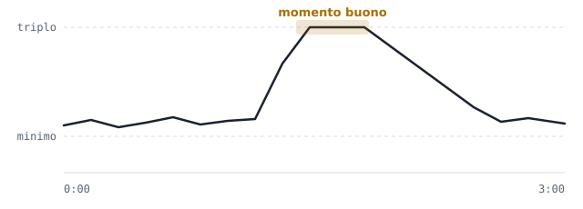

# Mercato come una borsa

> **Nel gioco da ottobre 2026** (specifica 1 di 3, [specifica completa](https://github.com/Juan0177/tIndustry/blob/main/docs/superpowers/specs/2026-10-22-mercato-borsa-design.md), lavoro seguito nell'issue [#268](https://github.com/Juan0177/tIndustry/issues/268)). Prezzi che si muovono, picchi, crolli e vendita automatica per oggetto ci sono già. Il magazzino del CORE e i livelli (specifica 3) ci sono già: ogni oggetto ha un massimo, la vendita automatica ha un ritmo che cresce col CORE. **Da novembre 2026 c'è lo schermo di borsa** ([specifica 2a](https://github.com/Juan0177/tIndustry/blob/main/docs/superpowers/specs/2026-11-04-schermo-borsa-design.md)): attaccato al CORE accende il jackpot in partita, e tre moduli della Ricerca aiutano a vendere al momento giusto. La sequenza animata del «Vendi tutto» (specifica 2b) arriverà dopo. I numeri esatti sono in [Economia e Ricerca](Economia-e-Ricerca#il-mercato).

tIndustry è un gioco in cui costruisci una fabbrica: scavi minerali, li porti in magazzino, li trasformi in prodotti e li vendi per guadagnare e costruire di più. Il Mercato funziona come una borsa, e vorremmo sapere cosa ne pensi.

## Come funziona

**I prezzi si muovono, come in borsa.** Ogni prodotto ha un prezzo minimo sotto il quale non scende mai. Di solito il prezzo sta un po' sopra il minimo e cambia di continuo, piano piano.

**Ogni tanto il prezzo schizza in alto.** Più o meno ogni quarto d'ora, per ogni prodotto, il prezzo sale in un attimo fino al triplo, resta lì qualche secondo e poi riscende. Chi vende in quel momento guadagna molto di più.

**Se vendi troppo tutto insieme, il prezzo crolla.** Come quando tutti vendono la stessa cosa nello stesso momento: per una ventina di minuti quel prodotto vale solo il minimo, e niente più rialzi. Gli altri prodotti non se ne accorgono: il crollo riguarda solo quello che hai svenduto.

**Puoi anche non pensarci.** C'è una vendita automatica, un interruttore per ogni prodotto, che vende da sola dal magazzino, a un ritmo che cresce con il CORE. È comoda, ma vende sempre al prezzo minimo. Con la spunta «solo a CORE pieno» vende soltanto quando il prodotto è al massimo del magazzino. E il magazzino ha un massimo: quando è pieno, la linea di quel prodotto si ferma.

*Un prodotto in tre minuti: un po' sopra il minimo, poi il rialzo fino al triplo, pochi secondi in cima e la discesa.*

## Il colpo di fortuna

Se durante un rialzo vendi in un colpo solo (**Vendi tutto**) una quantità enorme di un prodotto, puoi vincere un **jackpot**: quella vendita vale circa **dieci volte** il normale. Serve lo **schermo di borsa** attaccato al CORE (sotto): senza, il «Vendi tutto» vende e basta.

- Più vendi, più è probabile. Sotto i 400 pezzi non si tenta; con quantità piccole è raro; al massimo è **testa o croce** (una possibilità su due).
- Che vinca o no, una vendita così grande fa comunque crollare il prezzo di quel prodotto per un po'.
- Se un colpo va a vuoto senza far crollare il prezzo, per 5 minuti nessun «Vendi tutto» è possibile.

**La «rete di sicurezza».** Per non far arrabbiare chi è sfortunato, ogni volta che tenti il colpo grosso e non va, la volta dopo è più facile. Dopo **tre tentativi andati male di fila, il quarto vince di sicuro**. Funziona come in tanti giochi per telefono, dove dopo un certo numero di tentativi il premio raro è garantito.

## Lo schermo di borsa

Lo **schermo di borsa** è un blocco 2×2 che si sblocca nella Ricerca dopo l'assemblatore e si piazza dalla categoria Magazzino della palette. Se ne può avere **uno solo**, e va messo **a contatto col CORE** (lato contro lato). Non ha direzione e non usa corrente.

- **Accende il jackpot.** Finché lo schermo è finito e tocca il CORE, un «Vendi tutto» nel rialzo può vincere il colpo di fortuna. Se lo smonti, o resta staccato dal CORE, lo schermo lo dice («Staccato dal CORE») e il jackpot si spegne finché non lo riattacchi.
- **Segue un oggetto.** Fai clic sullo schermo (senza blocco scelto in palette) e scegli l'oggetto dalla griglia delle icone, come il filtro di un selezionatore. Lo schermo mostra l'icona, il prezzo del momento con la freccia, il grafico degli ultimi 2 minuti e la scritta «Crollo» se l'oggetto è crollato. Senza oggetto dice «Scegli un oggetto».
- **Fa vedere com'è andata.** Dopo ogni «Vendi tutto», per 6 secondi lo schermo mostra l'oggetto venduto, l'incasso e accende i LED della cornice:
  - **blu**: il prezzo è sceso poco (al massimo un decimo del prezzo minimo);
  - **viola**: il prezzo è sceso molto, oppure l'oggetto è crollato (o era già in crollo);
  - **gialli**: era il testa o croce da 10.000 pezzi in su, vinto o perso;
  - col **jackpot** i LED sono gialli, compare «JACKPOT» e lampeggiano le luci negli angoli.

  Passando col mouse sullo schermo il suggerimento spiega anche il colore dei LED, così non conta solo il colore.
- **Il CORE che cresce.** Lo schermo è un edificio come gli altri: se sta sulle celle dove il CORE deve allargarsi, il potenziamento è rifiutato finché non lo sposti. Conviene metterlo dove il CORE non cresce (vedi [Economia e Ricerca](Economia-e-Ricerca#i-tre-livelli)).

### I moduli della Finanza

Dopo lo schermo, la Ricerca ha tre **moduli** in fila. Non si piazzano: una volta sbloccati compaiono sullo schermo (per l'oggetto seguito) e nella panoramica del Mercato (una riga «Moduli» per ogni oggetto), ma solo finché lo schermo è attivo.

1. **Previsione**: «picco fra circa N min» e il consiglio «aspetta»; nel rialzo «vendi ora»; durante un crollo quanto manca alla fine; dopo un colpo a vuoto quanto resta del blocco del «Vendi tutto». Non prevede mai il jackpot.
2. **Percentuale**: il prezzo del momento come «+N% su B», cioè quanto sopra il prezzo minimo.
3. **Probabilità**: la probabilità del jackpot se ora facessi «Vendi tutto» di quell'oggetto, rete di sicurezza compresa (0% fuori dal rialzo, sotto i 400 pezzi o durante il blocco).

## Due esempi

**1. Aspettare conviene.** Hai 1.000 lastre di ferro da vendere.
- Le vendi subito con la vendita automatica: **23.000 $**.
- Aspetti un rialzo e le vendi lì: **67.000 $**, quasi il triplo.

**2. Il testa o croce.** Hai messo da parte una montagna di ferro e arriva un rialzo. Decidi di venderlo tutto in un colpo.
- Se va bene, jackpot: **630.000 $**.
- Se va male: **170.000 $**, che è comunque molto più dei 60.000 $ che avresti preso vendendo con calma al minimo.
- In tutti e due i casi il ferro poi resta fermo al minimo per un po', e intanto conviene vendere altro.

## Cosa ne pensi?

Le regole sono tutte nel gioco, jackpot compreso; le domande restano aperte nell'issue per ritoccare i numeri.

1. Ti piace l'idea che i prezzi si muovano e che convenga aspettare il momento giusto, o preferiresti vendere senza pensarci?
2. Il jackpot ti sembra divertente o troppo legato alla fortuna?
3. La «rete di sicurezza» (vittoria garantita dopo tre tentativi andati male) è giusta, troppo generosa o troppo avara?
4. Ti sembra giusto che un tentativo andato male faccia comunque crollare il prezzo, o è una punizione troppo dura?
5. Secondo te il gioco rischia di diventare più un gioco di borsa che di fabbriche?

<!-- navigazione: generata da tools/dev/wiki_navigazione.py -->

---

[Torna alla Home](Home)

<!-- /navigazione -->
