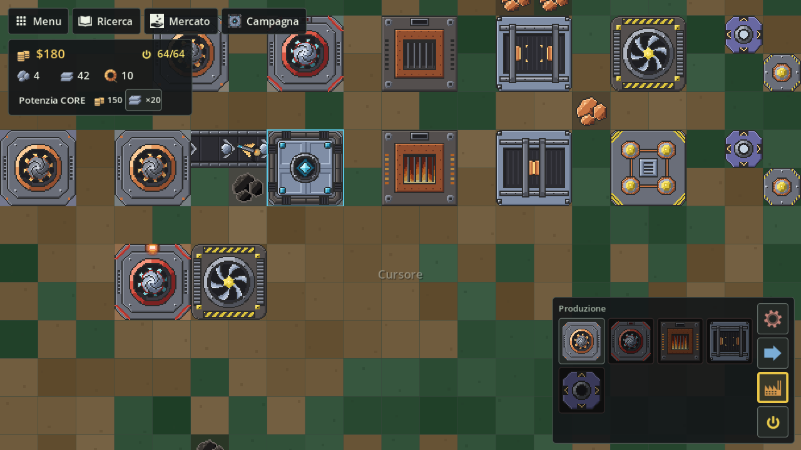

# Produzione

I blocchi che producono: minatori, trapano a impatto, forno, assemblatore, fonderia avanzata, pressa grande, separatore, plastificatore ed estrattore, con misure, costi, ritmi e consumi.

## In breve

| Blocco | Misura | Costo di costruzione | Sblocco | Cosa fa |
|---|---|---|---|---|
| Minatore T1 (`miner`) | 2×2 | 4 Ferro grezzo | iniziale | Estrae ferro, rame, carbone, piombo; sabbia dal pavimento di sabbia |
| Minatore T2 (`miner-advanced`) | 2×2 | 10 Lastre di ferro, 4 Fili di rame | Ricerca | Estrae tutto, titanio compreso, a velocità doppia |
| Trapano a impatto (`impact-drill`) | 3×3 | 40 Lastre di titanio, 20 Silicio, 20 Grafite | Ricerca | Estrae tutto fino a 4 pezzi al secondo, solo con corrente |
| Forno (`smelter`) | 2×2 | 6 Ferro grezzo | Ricerca | Fonde i minerali in lastre, a carbone o a corrente |
| Assemblatore (`assembler`) | 2×2 | 8 Lastre di ferro, 2 Rame grezzo | Ricerca | Filo di rame, grafite, silicio; circuiti dopo la Ricetta dei circuiti |
| Fonderia avanzata (`smelter-advanced`) | 2×2 | 30 Lastre di ferro, 15 Lastre di titanio, 10 Fili di rame | Ricerca | Le ricette del forno a velocità doppia, solo con corrente |
| Pressa grande (`graphite-press`) | 2×2 | 20 Lastre di ferro, 10 Lastre di piombo | Ricerca | 2 Grafite da 3 Carbone, senza corrente |
| Separatore (`separator`) | 2×2 | 20 Lastre di ferro, 10 Lastre di titanio, 10 Fili di rame | Ricerca | Un minerale a caso da 2 Sabbia, solo con corrente |
| Plastificatore (`plasticizer`) | 2×2 | 20 Lastre di titanio, 20 Lastre di piombo, 10 Silicio | Ricerca | Plastica da 2 Carbone, solo con corrente |
| Estrattore (`extractor`) | 1×1 | 2 Lastre di ferro | Ricerca | Tira oggetti fuori da un magazzino o da una macchina |

I costi di sblocco sono in [Economia e Ricerca](Economia-e-Ricerca). Le costruzioni non costano soldi, solo materiali presi dal CORE; smontarle rende tutto.

## Come entrano ed escono gli oggetti

- **Entrata**: un nastro che punta dentro il blocco gli consegna gli oggetti. Il blocco accetta solo quello che usa (ingredienti delle sue ricette, carbone come combustibile): un oggetto che non gli serve resta fermo sul nastro e lo blocca.
- **Uscita**: minatori e macchine mettono quello che producono su un nastro accanto a loro che **si allontana** dal blocco, su qualunque lato, a turno fra i nastri disponibili. Un nastro che punta verso il blocco non riceve nulla.
- **Contatto diretto**: se un minatore o una macchina tocca con un lato una macchina che usa quell'oggetto o il CORE, gli passa gli oggetti direttamente, senza nastro.

## Minatore T1

Si piazza su un giacimento. Con tutte e 4 le celle sul minerale produce **1 oggetto ogni 2 secondi**; con meno celle va più piano in proporzione (2 celle su 4: 1 oggetto ogni 4 secondi). Se copre più minerali scava quello presente nel maggior numero di celle. Non scava il titanio. Non usa corrente.

**Sabbia.** Un minatore (T1, T2 o trapano) che non ha sotto un giacimento che sa scavare, ma ha celle di pavimento di **sabbia** o **sabbia scura**, scava **Sabbia**, con l'efficienza delle celle di sabbia sull'impronta (sul T1 e sul trapano 3 celle su 4 danno tre quarti del ritmo; il T2 con il suo bonus del 25% arriva al massimo). Un giacimento scavabile vince sempre sulla sabbia. Il drone non scava sabbia a mano.

## Minatore T2

Come il T1 ma **velocità doppia** e ogni cella sul minerale conta il 25% in più, fino al massimo: con tutte e 4 le celle fa 1 oggetto al secondo. Scava anche il **titanio**. Se è nella rete di un generatore acceso (a contatto o con un laser di un nodo, vedi [Energia](Energia)) lavora fino al **20% più veloce** e consuma 0,5 unità di energia al secondo; con poca corrente il vantaggio cala in proporzione.

| Minatore | 4 celle su 4 | Con corrente |
|---|---|---|
| Minatore T1 | 1 ogni 2 s (0,5/s) | non la usa |
| Minatore T2 | 1 ogni 1 s (1/s) | 1,2/s |
| Trapano a impatto (9 celle su 9) | — (fermo) | 4/s |

## Trapano a impatto

Un minatore **3×3** di livello 3: scava ogni giacimento, titanio compreso, e come gli altri il minerale presente nel maggior numero delle sue 9 celle. Lavora **solo con la corrente** (30 unità al secondo mentre scava): senza corrente è fermo, con poca corrente va più piano in proporzione. Con tutte e 9 le celle sul minerale e la rete al 100% fa **4 pezzi al secondo**, quattro volte il Minatore T2 senza corrente; con meno celle va più piano in proporzione (celle coperte / 9, senza il +25% del T2). Mette i pezzi sui nastri dei suoi 12 lati, o direttamente nel CORE o in una macchina che tocca.

## Scavo a mano

Anche il drone può scavare: **tieni premuto il clic sinistro su un giacimento**, senza un blocco in mano, e finché il tasto è giù il drone estrae minerale e lo tiene nella **stiva**. Il giacimento non si consuma. Il livello del CORE decide cosa e quanto:

| Drone | Minerali | Ritmo | Stiva |
|---|---|---|---|
| Alpha (shard) | ferro, rame, piombo, carbone | 0,7 al secondo | 30 |
| Beta (foundation) | ferro, rame, piombo, carbone | 0,9 al secondo | 50 |
| Gamma (nucleus) | anche titanio | 1,1 al secondo | 70 |

- La stiva tiene **un solo tipo** di minerale alla volta; con la stiva piena di un minerale non si scava un altro.
- Quando il drone è entro **6 celle dal bordo del CORE** (0 sopra il CORE) la stiva passa da sola nel magazzino, fino al massimo del CORE per quell'oggetto; quello che non entra resta nella stiva. Con la stiva piena lontano dal CORE lo scavo aspetta, e il comando è rifiutato.
- Lo scavo si **annulla** se la cella esce dal raggio di 27,5 celle, o se sul giacimento ora c'è il CORE, un edificio, un nastro o un cantiere. Si **ferma** (e poi riprende) mentre il drone sta costruendo: se il cantiere è fermo perché mancano i materiali, un avviso lo dice; annulla il piano o allontanati per scavare.

## Forno

Fonde i minerali in lastre (ricette in [Risorse e oggetti](Risorse-e-oggetti)): Lastra di ferro, di piombo, di titanio, e la Sabbia in Vetro. Per lavorare serve **carbone oppure corrente**:

| Modo | Come funziona |
|---|---|
| A carbone | Il carbone che arriva va in una scorta di 8; ogni Carbone dà 6 secondi di lavoro |
| A corrente | Se è nella rete di un generatore consuma 8 unità di energia al secondo quando ha qualcosa da fondere e va fino al **20% più veloce**; se la corrente non basta e ha carbone, lo brucia e va a velocità normale |

Di ogni ingrediente tiene da parte al massimo 4 volte quanto ne chiede una ricetta (8 Ferro grezzo, 8 Piombo grezzo, 12 Titanio grezzo); oltre, il nastro aspetta. Vale anche per l'Assemblatore. Si accende (fuoco, fumo, luce di notte) solo quando lavora davvero.

## Assemblatore

Fa Filo di rame, Grafite e Silicio; dopo il nodo **Ricetta dei circuiti** della Ricerca anche il **Circuito** (1 Filo di rame + 1 Silicio + 1 Lastra di piombo in 3 s). Prima di quello sblocco non accetta niente per i circuiti. **Lavora anche senza corrente**; se è nella rete di un generatore consuma 10 unità di energia al secondo e va fino al 20% più veloce (meno, se la corrente non basta per tutta la rete). Avvia la prima ricetta per cui ha tutti gli ingredienti, nell'ordine Filo di rame, Grafite, Silicio, Circuito.

## Macchine della Ricerca allargata

Quattro macchine 2×2 senza direzione, che prendono e danno gli oggetti come il forno e l'assemblatore (nastri su ogni lato, contatto diretto, scorta di 4 ricette per ingrediente). Tutte si sbloccano in Ricerca (vedi [Economia e Ricerca](Economia-e-Ricerca)).

| Macchina | Ricette | Corrente |
|---|---|---|
| Fonderia avanzata | quelle del forno (lastre di ferro, piombo e titanio, vetro) a **velocità doppia** | **obbligatoria**, 20 unità al secondo mentre lavora; non brucia carbone e non lo accetta |
| Pressa grande | 3 Carbone → 2 Grafite in 1,5 s | **nessuna**: lavora sempre alla sua velocità e non fa parte della rete |
| Separatore | 2 Sabbia → **un** minerale a caso in 2 s: Ferro, Rame o Piombo grezzo (30% ciascuno) o Titanio grezzo (10%) | **obbligatoria**, 8 unità al secondo |
| Plastificatore | 2 Carbone → 1 Plastica in 2 s | **obbligatoria**, 6 unità al secondo |

Con la corrente obbligatoria la macchina lavora alla sua velocità per la soddisfazione della rete (al 50% va a metà) ed è ferma a 0. Il caso del separatore non usa un generatore casuale: il pezzo dipende dal seme della mappa, dall'id della macchina e da quanti pezzi ha già fatto, così la stessa partita dà sempre la stessa sequenza (anche dopo un salvataggio). Il pannello del blocco mostra le probabilità di ogni minerale.

## Estrattore

Un blocco 1×1 senza direzione, come l'*Unloader* di Mindustry. Messo a contatto con il CORE (o con un container o un vault, un forno, un assemblatore) sposta 11 oggetti al secondo dal blocco che li ha al prossimo blocco vicino che li accetta, per esempio un nastro. Il filtro si sceglie con un clic sul blocco; senza filtro prende a turno tutti gli oggetti. Non sposta mai da un magazzino a un altro. Regole complete in [Logistica](Logistica#estrattore).

## Vedi anche

- [Risorse e oggetti](Risorse-e-oggetti)
- [Energia](Energia)
- [Logistica](Logistica)

<!-- navigazione: generata da tools/dev/wiki_navigazione.py -->

---

[← Pagina precedente: Risorse e oggetti](Risorse-e-oggetti) · [Torna alla Home](Home) · [Pagina successiva: Logistica →](Logistica)

<!-- /navigazione -->
