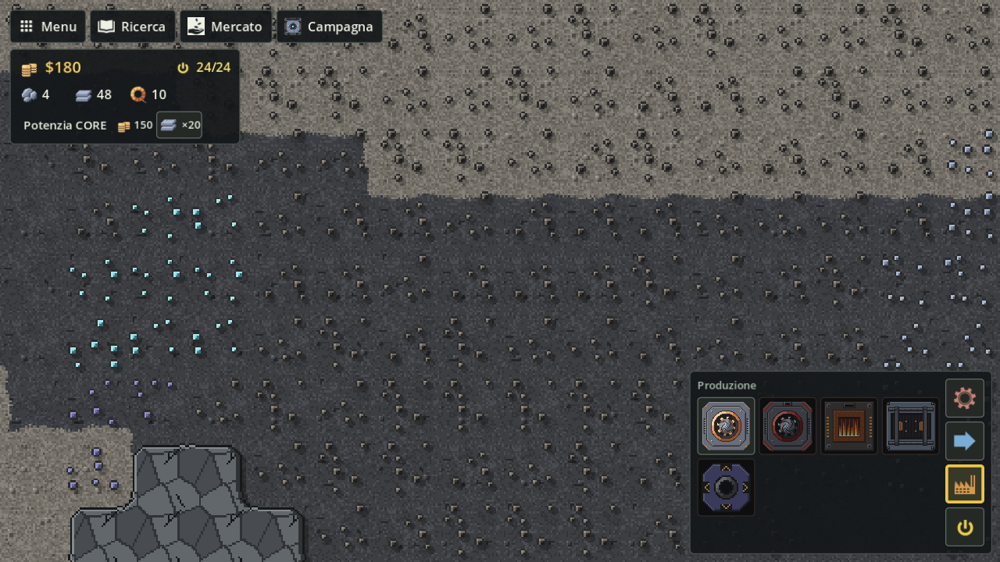

# Risorse e oggetti

I minerali che trovi sulla mappa, gli oggetti che produci e tutte le ricette, con quantità e tempi.



## Giacimenti

I giacimenti sono macchie di puntini colorati sul terreno. Un minatore piazzato sopra estrae il minerale del giacimento.

| Giacimento | Dà | Chi lo scava |
|---|---|---|
| ferro | Ferro grezzo | Minatore T1 e T2 |
| rame | Rame grezzo | Minatore T1 e T2 |
| carbone | Carbone | Minatore T1 e T2 |
| piombo | Piombo grezzo | Minatore T1 e T2 |
| titanio | Titanio grezzo | **Minatore T2** e **Trapano a impatto** |

Il titanio è più duro: come in Mindustry serve una trivella di livello più alto. Un Minatore T1 su un giacimento di solo titanio viene rifiutato ("Serve il Minatore T2 per il titanio"); su celle miste scava gli altri minerali e ignora il titanio. Quando un minatore copre più minerali, scava quello presente nel maggior numero di celle.

Il pavimento di **sabbia** (e sabbia scura) senza giacimento dà **Sabbia** a qualunque minatore piazzato sopra (vedi [Produzione](Produzione#minatore-t1)).

Nelle partite libere il CORE parte con ferro e rame vicini e una strada a terra verso ferro, rame e carbone. Nella campagna il titanio compare solo dal livello 9.

## Oggetti

| Oggetto | Id | Come si ottiene | A cosa serve |
|---|---|---|---|
| Ferro grezzo | `iron-ore` | Minatore su ferro | Lastre di ferro; costo di nastri, minatore, forno e logistica |
| Rame grezzo | `copper-ore` | Minatore su rame | Filo di rame; costo dell'assemblatore |
| Carbone | `coal` | Minatore su carbone | Combustibile di forno e generatore; grafite e silicio |
| Piombo grezzo | `lead-ore` | Minatore su piombo | Lastre di piombo; costo di nastri T2, selezionatore, ponte |
| Titanio grezzo | `titanium-ore` | Minatore T2 su titanio | Lastre di titanio; costo dei nastri T2, T3 e rinforzato |
| Lastra di ferro | `iron-plate` | Forno | Filo di rame; costo di edifici, sblocchi e potenziamento del CORE |
| Lastra di piombo | `lead-plate` | Forno | Silicio |
| Lastra di titanio | `titanium-plate` | Forno | Si vende (dopo il Circuito, il valore base più alto) |
| Filo di rame | `copper-wire` | Assemblatore | Costo di nodi, Lampada, Minatore T2 e sblocchi di energia |
| Grafite | `graphite` | Assemblatore | Costo di Nastro T3 e Nastro rinforzato |
| Silicio | `silicon` | Assemblatore | Costo del Nastro T3; circuiti |
| Sabbia | `sand` | Minatore su pavimento di sabbia | Vetro (forno, fonderia avanzata); minerali col separatore |
| Vetro | `glass` | Forno o fonderia avanzata | Si vende |
| Plastica | `plastic` | Plastificatore | Si vende |
| Circuito | `circuit` | Assemblatore, dopo la Ricetta dei circuiti | Si vende (l'oggetto più caro) |

Tutto quello che arriva al CORE va nel suo magazzino (o si vende subito, con la vendita automatica): da lì si pagano costruzioni e sblocchi. I prezzi di vendita sono in [Economia e Ricerca](Economia-e-Ricerca).

## Ricette

Il Forno e la Fonderia avanzata hanno le ricette `smelt-…`, l'Assemblatore quelle `craft-…`, la Pressa grande `press-…`, il Separatore `separate-…`, il Plastificatore `plasticize-…`. Non si sceglie la ricetta: la macchina avvia la prima, nell'ordine della tabella, per cui ha già tutti gli ingredienti. Con la corrente il Forno e l'Assemblatore lavorano il 20% più veloci; la Fonderia avanzata fa le ricette del forno in metà tempo, ma solo con la corrente.

| Ricetta | Macchina | Ingredienti | Prodotto | Tempo | Con corrente |
|---|---|---|---|---|---|
| Lastra di ferro (`smelt-iron`) | Forno | 2 Ferro grezzo | 1 Lastra di ferro | 2 s | 1,67 s |
| Lastra di piombo (`smelt-lead`) | Forno | 2 Piombo grezzo | 1 Lastra di piombo | 1,8 s | 1,5 s |
| Lastra di titanio (`smelt-titanium`) | Forno | 3 Titanio grezzo | 1 Lastra di titanio | 3,2 s | 2,67 s |
| Filo di rame (`craft-copper-wire`) | Assemblatore | 1 Rame grezzo + 1 Lastra di ferro | 2 Fili di rame | 1,5 s | 1,25 s |
| Grafite (`craft-graphite`) | Assemblatore | 2 Carbone | 1 Grafite | 1,2 s | 1 s |
| Silicio (`craft-silicon`) | Assemblatore | 1 Lastra di piombo + 1 Carbone | 1 Silicio | 2,4 s | 2 s |
| Vetro (`smelt-glass`) | Forno | 2 Sabbia | 1 Vetro | 2 s | 1,67 s |
| Grafite (`press-graphite`) | Pressa grande | 3 Carbone | 2 Grafite | 1,5 s | non la usa |
| Minerali dalla sabbia (`separate-sand`) | Separatore | 2 Sabbia | 1 pezzo a caso: Ferro, Rame, Piombo grezzo (30% ciascuno), Titanio grezzo (10%) | — | 2 s (solo con corrente) |
| Plastica (`plasticize-plastic`) | Plastificatore | 2 Carbone | 1 Plastica | — | 2 s (solo con corrente) |
| Circuito (`craft-circuit`) | Assemblatore, dopo la Ricetta dei circuiti | 1 Filo di rame + 1 Silicio + 1 Lastra di piombo | 1 Circuito | 3 s | 2,5 s |

Nella Fonderia avanzata le ricette `smelt-…` durano la metà del tempo senza corrente della tabella (Lastra di ferro 1 s), a rete piena.

Il Forno brucia anche carbone come combustibile se non ha corrente: 1 Carbone ogni 6 secondi di lavoro (vedi [Produzione](Produzione)).

## Catene tipiche

```text
ferro ──▶ Forno ──▶ Lastra di ferro ──┐
rame ─────────────────────────────────┴──▶ Assemblatore ──▶ Filo di rame
piombo ──▶ Forno ──▶ Lastra di piombo ──┐
carbone ────────────────────────────────┴──▶ Assemblatore ──▶ Silicio
carbone ──▶ Assemblatore ──▶ Grafite
titanio ──▶ (Minatore T2) ──▶ Forno ──▶ Lastra di titanio
sabbia ──▶ Forno ──▶ Vetro
sabbia ──▶ Separatore ──▶ ferro, rame, piombo o titanio
carbone ──▶ Plastificatore ──▶ Plastica
Filo di rame + Silicio + Lastra di piombo ──▶ Assemblatore ──▶ Circuito
```

## Vedi anche

- [Produzione](Produzione)
- [Economia e Ricerca](Economia-e-Ricerca)
- [Campagna e mappe](Campagna-e-mappe)

<!-- navigazione: generata da tools/dev/wiki_navigazione.py -->

---

[← Pagina precedente: Comandi](Comandi) · [Torna alla Home](Home) · [Pagina successiva: Produzione →](Produzione)

<!-- /navigazione -->
